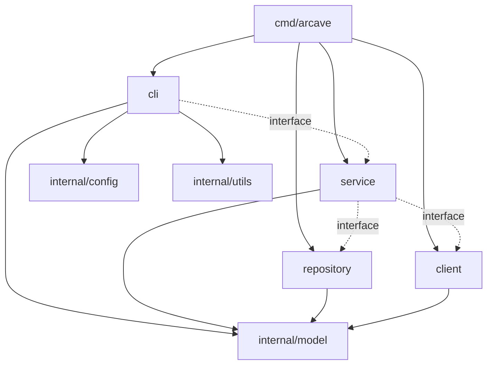

# Contributing to arcave

How we develop arcave. A pull request is reviewed against this document.

## Workflow

- Branch off `main`: `feat/<subject>`, `fix/<subject>`, `docs/<subject>`.
- One pull request, one change.
- Commit messages follow [Conventional Commits](https://www.conventionalcommits.org/):
  `type(scope): summary`, imperative, lowercase. A breaking change carries `!`.
- Before you push:

  ```bash
  make build
  make lint
  make test
  ```

  `make test` runs the unit tests, then the integration tests under `test/`, which need a
  running Docker daemon. `make test-unit` runs the unit tests alone and needs none.

  `make test-fidelity` runs the spec-fidelity catalog against a live Docker daemon. Run it
  when you touch introspection, the compose spec or the compose client. `make test-storage`
  runs the end-to-end workflow on every storage backend, each against its server in a
  container.

## Go conventions

Write idiomatic Go: [Effective Go](https://go.dev/doc/effective_go) and
[Go Code Review Comments](https://go.dev/wiki/CodeReviewComments) are the baseline.

### Naming

- A name says what a thing does, to someone reading it for the first time.
- Name functions with a verb (`loadSavepoint`, `findSessionByRef`), so a call reads as
  an action.
- Export only what another package uses.

### Errors

- Wrap every returned error with what you were doing, as a verb and a noun:

  ```go
  if err != nil {
      return fmt.Errorf("load savepoint %s: %w", id, err)
  }
  ```

  Not `return err`. The message is lowercase, with no "failed to", and wraps with `%w`.
- An error callers must match is a sentinel or typed error in `internal/model`, matched
  with `errors.Is` or `errors.As`.
- Handle an error once: return it or log it. A failure during cleanup is logged, not
  returned over the original error.
- Don't panic in library code.

### Context and logging

- `ctx context.Context` is the first parameter of anything that does I/O or blocks.
- Logs go to stderr through `zerolog.Ctx(ctx)`. Command output is JSON on stdout.

### Simplicity

- Write the simplest code that does the job.
- No speculative code: no unused parameters, no functions only tests call.
- Prefer returning values to mutating arguments.

## Architecture

Dependencies point inwards only:



A solid arrow is an import. A dotted arrow is a call through an interface the caller
declares, with no import; `cmd/arcave` wires the concrete types in.

- `model`: domain types and sentinel errors. Imports no arcave package.
- `repository`: storage CRUD, no business logic.
- `client`: the outside world (Docker API, compose). Imports only `model`.
- `service`: business logic. Reaches repositories and clients only through interfaces.
- `cli`: adapters that parse input, call a service and print the result. Besides `model`, it
  imports only `config` and `utils`.
- `cmd/arcave`: the composition root, the only place concrete types are wired together.

Interfaces belong to the consumer: a service declares the small interface it needs next
to the code using it. Depend on an interface wherever a collaborator does I/O, so unit
tests run without a daemon, a filesystem or a network.

## Testing

- Every change comes with tests. A bug fix starts with a failing test.
- Unit tests mock interfaces and need no Docker daemon. Tests needing one live under
  `test/` and skip themselves without it.
- Table-driven where a behaviour has several input/output pairs.
- testify: `require` for preconditions, `assert` for the values under test. Mocks are
  strict: every mock ends with `AssertExpectations(t)`.
- Arrange, Act, Assert, separated by blank lines.
- Name tests `Test{Type}_{Method}[_{Case}]`.
- No `time.Sleep` for synchronisation.

## Documentation

- Exported identifiers have a one- or two-line doc comment starting with their name.
- A comment says what the code does, and why only when that isn't obvious.
- A user-facing change updates `README.md` or `docs/` in the same pull request.

## Using AI agents

You may use an AI agent, but you own its output: read every line before you submit it.
Keep comments, commit messages and PR descriptions as short as possible. No AI slop: no
filler, no restating the code in prose, no self-praise, no emoji.
