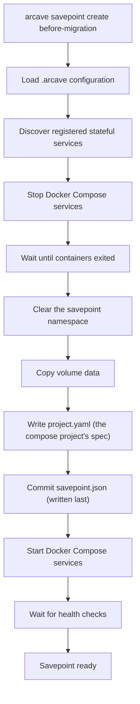
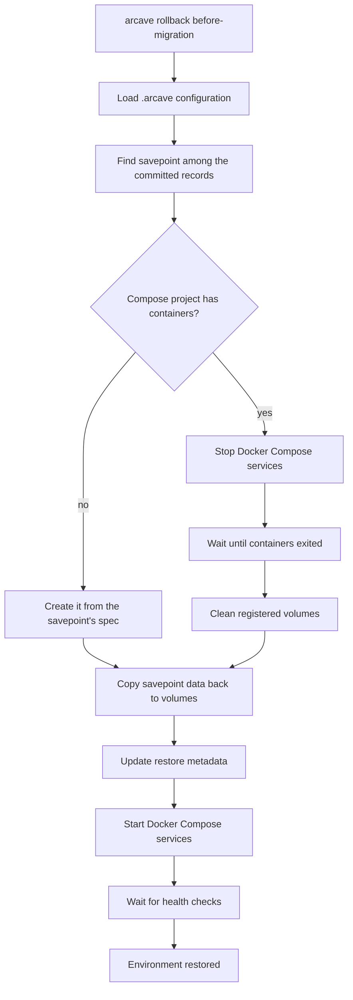

# Implementation Spec

## Project Overview

arcave is a local environment lifecycle manager for stateful Docker Compose applications.

Modern development workflows make it easy to version source code, but stateful services such as PostgreSQL, MySQL,
Redis, MongoDB, and Kafka remain difficult to manage. Developers frequently need to experiment with schema migrations,
data transformations, test automation, AI agents, and application changes that modify persistent state. Recovering from
mistakes often requires recreating environments, reloading datasets, or manually restoring backups.

arcave introduces savepoints and fast environment recovery for Docker Compose projects, allowing developers and AI agents to
safely iterate on stateful systems.

A savepoint captures a consistent snapshot of an environment at a specific moment in time. If an experiment, migration,
or code change fails, the environment can be quickly restored to a previously known state.

arcave is designed around the emerging agent-driven development workflow, where AI agents continuously modify code, execute
migrations, run tests, and interact with databases as part of an iterative development cycle.

A typical agent development loop looks like:

1. Create a savepoint.
2. Apply code or schema changes.
3. Execute tests and validation.
4. If successful, continue to the next iteration.
5. If validation fails, rollback to the previous savepoint.

This enables rapid experimentation without the cost of recreating environments or manually restoring databases.

arcave can be used directly through its CLI:

```bash
arcave savepoint create before-migration
arcave rollback before-migration
```

or through the arcave MCP server, allowing AI agents to invoke savepoint, restore, clone, and environment management
operations as native tools.

By providing a lightweight state management layer for Docker Compose environments, arcave enables both developers and AI
agents to safely explore, test, and recover stateful application changes with minimal operational overhead.

The long-term vision is to provide a generic environment state management platform that supports savepoints, rollback,
cloning, branching, and automated recovery workflows across a wide range of databases and stateful services.

---

## Savepoint Process

Here is an example of the savepoint creation workflow:



Pseudo-code for the `arcave savepoint create` command:

```shell
arcave savepoint create before-migration

# 1. Stop services
docker compose stop

# 2. Clear the namespace, dropping anything a crashed run left behind
rm -rf .arcave/savepoints/myapp/019e843e-1650-7000-8000-000000000000

# 3. Copy registered volumes
cp -a pgdata .arcave/savepoints/myapp/019e843e-1650-7000-8000-000000000000/postgres
cp -a redisdata .arcave/savepoints/myapp/019e843e-1650-7000-8000-000000000000/redis

# 4. Record the compose project this savepoint was taken of
write .arcave/savepoints/myapp/019e843e-1650-7000-8000-000000000000/project.yaml

# 5. Commit the savepoint — the record is written LAST
write .arcave/savepoints/myapp/019e843e-1650-7000-8000-000000000000/savepoint.json

# 6. Start services
docker compose start

# 7. Wait healthy
```

The record is the commit marker. A crash before step 5 leaves volume data that no
record names: `arcave savepoint list` skips it, and it is safe to reclaim. There is no
window in which a savepoint lists without its data.

Removal runs the same steps in reverse, uncommitting first: `savepoint.json` is
deleted before the namespace it lives in, so the only observable states are
"fully present" and "gone".

One store holds everything, a rollback's safety snapshot included: it is an ordinary savepoint, with its own record, marked with the label `arcave-safety-snapshot=true`. The mark is what hides it — `arcave savepoint list` and every scanning selector (`latest`, a name, `--retain-recent`, `--retain-for`, `--before-date`) skip it, while an explicit id reaches it. A rollback deletes its own snapshot on success and after a successful revert; the one left behind by a killed rollback is the last copy of the pre-rollback state, and that asymmetry is the whole reason the record exists. Recovering from it is manual — `arcave savepoint list --include-safety-snapshots` to find the id, `arcave rollback <id>` to apply it, `arcave savepoint remove --ids <id>` to be rid of it. arcave does not finish a rollback it died in the middle of.

---

## Rollback Process



---

## Future Optimization

The current MVP implementation restores an environment by deleting the contents of the active volume and copying data
back from the selected savepoint. This approach is intentionally simple, portable, and easy to validate.

In future versions, the restore process can be optimized by introducing volume-level snapshot backends and volume
swapping. Instead of physically copying data, arcave would switch the active volume reference to a previously created
snapshot or clone. This would reduce restore time from being proportional to dataset size to being nearly instantaneous,
limited primarily by container restart and health check time.

The restore workflow would evolve from:

`Stop Services → Delete Data → Copy Snapshot → Start Services`

to:

`Stop Services → Swap Volume → Start Services`

The architecture should therefore be designed around pluggable snapshot backends, allowing the MVP copy-based
implementation to be replaced later with more advanced technologies such as rsync-based snapshots, filesystem-level
copy-on-write clones, or storage-native snapshot mechanisms without changing the user-facing workflow.

---

## arcave CLI UX

### Global flags

```text
-p, --project-name        The Docker Compose project to act on, as `docker compose ls` names it.
                          Required by every command that touches a compose project — savepoint create/list/remove
                          and rollback — and read from ARCAVE_PROJECT_NAME when the flag is absent.
                          `arcave init` names no compose project and does not take it; `arcave mcp` serves
                          many, so each of its tool calls names its own.
    --session             The session to work in, by id or name; read from ARCAVE_SESSION when the flag is
                          absent, `baseline` when neither is set. Unbound, like -p: there is no current-session
                          pointer, so a command that names none works in `baseline`.
    --config              Path to the config file (default: .arcave/config.yaml under the project root).
    --log-level           debug | info | warn.
    --log-format          text | json.
    --wait-timeout        How long to wait for services to become healthy after a restart.
    --stop-timeout        The least time a container gets to exit on its own before it is killed;
                          a service's stop_grace_period raises it.
    --progress            Where compose's own progress goes: log | tty | quiet.
```

The compose project name is deliberately not a config key: one project directory may hold several compose
projects, and a persisted name would pin arcave to one of them. `project.name` in the config is the *arcave
project*, a different concept — it scopes the savepoint store, not the compose project arcave acts on.

### Project Initialization

#### arcave doctor

Analyzes the current Docker Compose project and validates whether it is compatible with arcave savepoint and restore
workflows.

The command performs static analysis of the project and reports potential issues, warnings, and recommendations.

The command never modifies project files.

```bash
arcave doctor
```

##### Checks

###### Project Validation

- Docker Compose file exists.
- Compose file can be parsed successfully.
- Project contains services.

###### Stateful Service Detection

Detects known stateful services:

- PostgreSQL
- MySQL
- MariaDB
- Redis
- MongoDB
- Kafka
- Elasticsearch

and reports whether arcave can manage their persistent state.

###### Volume Validation

Checks:

- Named volume is configured.
- Bind mounts are used.
- Anonymous volumes are used.
- Stateful services store data inside container filesystem.

###### Health Check Validation

Checks whether services define Docker health checks.

Missing health checks are reported as warnings because arcave restore operations rely on service readiness detection.

###### Service Dependency Validation

Analyzes:

- `depends_on` relationships
- shared networks
- environment variables

and identifies services that may continue writing into stateful systems.

###### arcave Initialization State

Checks:

- `.arcave` directory exists
- `config.yaml` exists
- the savepoint store is reachable and holds no legacy `manifest.json`

###### Storage Validation

Checks:

- Snapshot directory accessibility
- Available disk space
- Estimated snapshot size

##### Output Format

All output is returned as JSON.

Example:

```json
{
  "project": {
    "name": "myapp"
  },
  "status": "warning",
  "issues": [
    {
      "severity": "warning",
      "service": "postgres",
      "code": "MISSING_PERSISTENT_VOLUME",
      "message": "PostgreSQL service does not use a named persistent volume.",
      "suggested_fix": {
        "service": "postgres",
        "volume": "postgres_data",
        "mount_path": "/var/lib/postgresql/data"
      }
    },
    {
      "severity": "warning",
      "service": "postgres",
      "code": "MISSING_HEALTHCHECK",
      "message": "PostgreSQL service does not define a health check."
    },
    {
      "severity": "info",
      "service": "app",
      "code": "WRITER_DEPENDENCY_DETECTED",
      "message": "Application service appears to depend on PostgreSQL."
    }
  ],
  "summary": {
    "errors": 0,
    "warnings": 2,
    "infos": 1
  }
}
```

##### Exit Codes

```text
0  healthy
1  warnings detected
2  errors detected
```

##### Integration with arcave fix

Doctor never changes anything.

Suggested fixes can be automatically applied later using:

```bash
arcave fix
```

which consumes doctor recommendations and updates the project configuration accordingly.

---

#### arcave init

Initializes arcave metadata for the current project.

```bash
arcave init
```

Behavior:

- Creates `.arcave` directory.
- Discovers stateful services.
- Creates initial configuration.
- Optionally adds `.arcave` to `.gitignore`.

Result:

```text
.arcave/
├── config.yaml                          # written by `arcave init`
├── lock                                 # flock target; serialises mutating workflows
└── savepoints/<project-name>/           # the savepoint store, created by `arcave init`
    ├── shared/oci/blobs/sha256/         # image layers shared by every savepoint here
    └── <savepoint-id>/                  # one self-contained namespace per savepoint
        ├── savepoint.json               # the record — written last, the commit marker
        ├── project.yaml                  # the compose project's spec, what a rollback rebuilds from
        ├── <service>/<mount-path>/data.tar
        └── images/<service>/replicas/<n>/  # the container's committed writable layer
            ├── image.json               #   what to rebuild it from — written last
            └── index.json, manifest.json, oci-layout
```

Each savepoint is one self-contained directory: its record and every archive it
names live under the same namespace, so `cp -r <id>/` moves the whole savepoint.
The record sits at the root of the store's namespace rather than in `.arcave/`, so
pointing `storage.directory.path` at remote storage carries the records along with
the data they describe.

`config.yaml` is the one file arcave reads through the OS rather than through the
storage backend — it is what says where the storage backend points.

```yaml
project:
  name: myapp
docker:
  host: unix:///var/run/docker.sock     # "" => read the environment
storage:
  type: directory                       # directory | s3 (future)
  directory: {path: .arcave/savepoints/myapp}
snapshot:
  backend: fullcopy
rollback:
  leftover_volumes: overwrite           # overwrite | refuse
log: {level: info, format: text}
```

`rollback.leftover_volumes` says what a rollback into a compose project that is not
running does with the named volumes its `docker compose down` left behind: `overwrite`
(the default) restores over them and warns, naming each one; `refuse` fails the rollback
before anything is loaded or created.

`storage` is a tagged union: `type` names the arm, and that arm must be present.
Unknown keys are an error, not a value silently ignored — arcave never rewrites the file silently, since that would clobber a path the user set deliberately.

A savepoint store may not be `/`, a shallow system directory, `$HOME`, or any
ancestor of the project.

---

### Savepoint Management

#### arcave savepoint create

Creates a new environment savepoint.

```bash
arcave savepoint create \
    [--name before-migration] \
    [--description "Before applying migration 2026_001"]
```

Behavior:

- Stops project services.
- Creates snapshots of all registered stateful service volumes.
- Commits each container's writable layer and stores the image.
- Restarts services.
- Waits for health checks.

##### What a savepoint covers

A savepoint has two halves, and they never overlap: the **volumes** below, and the **writable layer** of every container the compose project holds. `docker commit` excludes the contents of every mount by contract, so the layer capture sees exactly the state the volume capture cannot — data a service wrote past all of its mounts.

**Layers are deduplicated.** The save archive is split: its parts go into `shared/oci/blobs/sha256/` under the digests they already carry, and the savepoint keeps only the archive's metadata and `image.json`, a manifest naming what to rebuild from — so the base image every savepoint carries is written once. `images[].size_bytes` is the image's own size and `images[].stored_bytes` is what that capture actually added to the store: the pair is where the saving is visible.

This needs **Docker 25 or newer**, whose `docker save` writes an addressable archive. On an older daemon `savepoint create` and `rollback` refuse before touching anything — nothing is stopped and nothing loaded — with `unsupported docker daemon`; there is no quieter mode to fall back to. `savepoint list` and `savepoint remove` touch no image and work on any daemon.

Blobs are shared across savepoints of one compose project, never across sessions, and nothing collects them yet — `savepoint remove` frees a savepoint's own namespace and leaves the shared blobs alone. Data belongs in volumes; the layer capture is what keeps a compose project honest when it is not there.

**A rollback restores the layer.** It loads each stored image back into the daemon before it stops anything, and rebuilds the containers on those images rather than on the base image the spec names.

The unit of backup is the **volume**, not the mount:

- Every named volume of the project the daemon reports — including ones no service mounts, and including `external: true` ones that some service does mount. An external volume nothing mounts is invisible: arcave reads the running compose project, and only compose's own volumes carry the project label that would reveal it.
- Every bind mount, one unit per service and target, and every anonymous volume, one unit per replica. A named volume three services mount is one unit, captured once.
- Mounts that are not persistent data are skipped, each reported with its reason: `tmpfs`, `npipe`, `image` and `cluster`.

A volume is addressed directly — a named volume by its docker name, a bind by its host path — and read and written through a throwaway container of arcave's own. The project's own containers need not be running, only to exist. The one exception is an **anonymous volume**: its docker name is created per container, so arcave has to ask the daemon through that service's container, and a create fails if it is gone. In a rollback the question is asked after the compose project has been built back, of the fresh container: the anonymous volume the teardown orphaned is not the one the data goes into, and it is removed once the restore has succeeded.

Two things follow that a user with a `subpath:` mount will not expect:

- A volume mounted through `subpath:` is captured **whole**: the unit is the volume, and the subpath is a property of one mount of it.
- **A rollback therefore restores the whole volume**, not the subdirectory the service sees. Everything else in that volume goes back to its savepoint state too.

A named volume that does not exist on the daemon is an **error**, not a skip: an empty capture would silently wipe live data at the next rollback. Bring the project up once (`docker compose up`) to create the volumes it declares.

What a rollback cannot bring back of a compose file is listed once, in the user docs: [Limitations](../docs/reference/limitations.md#some-compose-settings-do-not-survive-a-rollback).

arcave reads the **running compose project**, not the compose files — it never opens one, and a project whose files have moved or been deleted works exactly the same. The compose project itself, though, has to exist on the daemon. `docker compose stop` is fine — stopped containers still describe the compose project, and every workflow stops the services anyway. `docker compose down` is not: it removes the containers, and with them everything arcave knows about the project. A command run against a torn-down compose project fails saying so.

Every savepoint receives a unique immutable identifier — a UUIDv7 in canonical form, which sorts by creation time:

```text
019e843e-1650-7000-8000-000000000000
```

Metadata stored in `<savepoint-id>/savepoint.json`. `spec` names the compose document committed beside it as `<savepoint-id>/project.yaml` — the compose project as it stood, which is what a rollback rebuilds. It is read and parsed before a rollback stops anything, so an unloadable one fails while the project is still running:

```json
{
  "id": "019e843e-1650-7000-8000-000000000000",
  "name": "before-migration",
  "description": "Before applying migration 2026_001",
  "created_at": "2026-06-01T19:41:12.123456789Z",
  "images": [
    {
      "service": "webapp",
      "replica": 1,
      "container_id": "3f1a…",
      "container_name": "demo-webapp-1",
      "committed_image_id": "sha256:aaaa…",
      "upstream_image_id": "sha256:bbbb…",
      "upstream_image_ref": "myapp:latest",
      "size_bytes": 83887104,
      "stored_bytes": 1048576
    }
  ],
  "upstream_images": [
    {
      "id": "sha256:bbbb…",
      "refs": ["myapp:latest"],
      "repo_digests": ["myapp@sha256:cccc…"],
      "size_bytes": 82838528,
      "stored_bytes": 14336,
      "stored": true
    }
  ],
  "spec": {
    "format": "compose-yaml"
  },
  "not_covered": {
    "mounts": [
      {
        "service": "webapp",
        "target": "/tmp/cache",
        "raw_type": "tmpfs",
        "reason": "tmpfs",
        "detail": "non-persistent (tmpfs lives in RAM)"
      }
    ],
    "services_without_volumes": ["proxy"],
    "killed_containers": [{ "service": "db", "replica": 1, "container": "demo-db-1" }],
    "replica_gaps": [{ "service": "worker", "replicas": [1, 3], "missing": [2] }],
    "unresolved_upstreams": [{ "service": "job", "replica": 1, "container": "demo-job-1", "image": "arcave/demo-job-1-busybox:sp-019e83ef-ee80-7000-8000-000000000000" }]
  }
}
```

`not_covered` is what the savepoint does **not** hold, and is absent when it holds everything. It is in the record, so `savepoint list` and the MCP tools show it too:

- `mounts` — the mounts the backup decision skipped. `reason` is a stable code to match on: `tmpfs`, `npipe`, `image`, `cluster`, `unknown_type`, or `inherited_from_outside` (a `volumes_from` mount of a container outside the project). `detail` is the prose, and may change.
- `services_without_volumes` — services no captured volume belongs to; only their writable layer is held.
- `killed_containers` — replicas the stop deadline SIGKILLed, by service, replica and container name; their volumes may hold a crash state.
- `replica_gaps` — services missing a replica below their highest one; a rollback brings back exactly the numbers listed.
- `unresolved_upstreams` — containers whose upstream image cannot be named; their layer is held, the image under it is not.

Every entry is also logged as a warning on stderr.

`images` holds what `docker commit` made of each container: its upstream plus the writable layer. `upstream_images` holds each distinct image the compose file named, once, whether or not a layer was captured over it. `stored: false` means neither the store nor the daemon had it, so only its identity is recorded.

A rollback's safety snapshot carries the same two halves as any other savepoint — it differs only in its name, its empty description and the label that hides it from `savepoint list`.

---

#### arcave savepoint list

Lists available savepoints.

```bash
arcave savepoint list
arcave savepoint list --include-safety-snapshots
```

Options:

```text
--include-safety-snapshots   Also list the safety snapshots a rollback takes of the live state.
                           Hidden by default: one exists only while a rollback runs. One that
                           outlived its rollback is that rollback's last copy of the
                           pre-rollback state, and can be rolled back to by id.
```

Output:

```json
[
  {
    "id": "019e843e-1650-7000-8000-000000000000",
    "name": "before-migration",
    "description": "Before applying migration 2026_001",
    "created_at": "2026-06-01T19:41:12.123456789Z"
  }
]
```

---

#### arcave savepoint remove

Removes savepoints.

```bash
arcave savepoint remove --retain-recent 10
arcave savepoint remove --retain-for 30d
arcave savepoint remove --before-date 2026-01-01T00:00:00Z
arcave savepoint remove --dry-run --retain-for 14d
```

Options:

```text
--before-date string   Delete savepoints older than the specified RFC3339Nano timestamp.
--dry-run              Show savepoints that would be deleted without deleting them.
--retain-for duration  Retain savepoints for the specified duration. Example: 1w2d3h4m5s
--retain-recent int    Retain the most recent N savepoints.
```

---

### Sessions

A session is an independent line of savepoints inside the arcave project; its store lives at
`projects/<arcave-project>/sessions/<id>/`, and its record `session.json` is written last. Every id is a canonical
UUID — new ones UUIDv7 — and the default session's is `00000000-0000-0000-0000-000000000001`, named `baseline`; it has none
and always exists. These commands name no compose project and reach no daemon.

```text
arcave session list [--all]         # JSON array of {id, name, status, error, created_at, from, savepoint_count, compose_projects, size_bytes}
arcave session create [--name N] [--from S]  # an empty session, or a copy of S; prints its record
arcave session delete [--force] <id|name>  # {session, deleted: true, freed_bytes}
```

`--name` is optional and may be anything not blank — `/` and a UUID's shape included — but must be unique within
the arcave project (`baseline` is taken by the default session) and must not be another session's id.
`--session` and `session delete` look a value up as a name first, then as an id; several sessions carrying the name
is an error listing their ids.
`size_bytes` sums the size of every object under `sessions/<id>/`, read from the store's listing — no object is read —
so it counts orphans, unpruned restic data and uncollected image blobs, which a sum over the records would miss; it is
what deleting the session frees, and `session delete` reports it as `freed_bytes`, measured before it deletes.
`session delete` drops the record first, then the session's tree. It refuses `baseline` and a session the
inflight marker names, and leaves any running compose project alone.
`status` is `ready` for a session with a record. `session list --all` adds every `sessions/<id>/` tree without one,
its status read from its `heartbeat.json`: `cloning` while the heartbeat is `in-progress` and younger than its stale
age (30 min, by the store's `LastModified`), `failed` once it is `failed` or stale — `error` then carries the
heartbeat's — `incomplete` for a `done` heartbeat or none (an interrupted delete, or a tree arcave did not write), and
`unknown` for a heartbeat that cannot be read or reports another operation in progress — `error` then says which.
A tree whose savepoints cannot be read, as one mid-copy, is still listed, its counts left empty.
Such a tree has no name; `created_at` and `from` come from its heartbeat. `session delete <id>` deletes it; a
`cloning` one only with `--force` (`session is still being cloned` otherwise): holding the lock, no fork runs on this
host, so the heartbeat is a killed fork's. An `unknown` one is refused likewise (`session tree status is unknown`).
`session create --from <session>` (the fork) takes a session by name or id, `baseline` included, and copies everything
under `sessions/<source>/` but its record and its `heartbeat.json` into the new session's tree — every compose project, every savepoint with
its id and name, `shared/oci` and the restic repositories — then writes the record last, with `from: {session}`. It
holds the lock for the whole copy and touches no daemon; a failure or an interrupt creates nothing and leaves the copied
tree in the store, its `heartbeat.json` marked `failed` for a gc. A fork is deployed by an ordinary `rollback --session <new>`. It is not refused by an inflight marker: the
marker guards the daemon, which a fork does not touch.

### Environment Recovery

#### arcave rollback

Restores the environment to a specified savepoint.

```bash
arcave rollback latest
arcave rollback 019e843e-1650-7000-8000-000000000000
arcave rollback before-migration
```

The argument names the savepoint in one of three ways, and which one it is decided by the token itself: `latest` is reserved, a canonical UUID is an **id** (that being exactly what a savepoint id is), and anything else is a **name**. An id is exact and never falls back to a name — and `savepoint create` refuses a name shaped like one, so no savepoint is *called* an id — and it is the only form that reaches a safety snapshot. A name matching several savepoints is an error listing the candidate ids, never a silent guess.

Behavior:

- Reads the live compose project and refuses a daemon older than Docker 25, before anything is loaded or stopped.
- Loads every writable layer the savepoint holds back into the daemon and tags each one `arcave/<project>-<service>-<replica>-<base-image>:sp-<savepoint-id>` — e.g. `arcave/shop-db-1-postgres-16:sp-019e843e-1650-7000-8000-000000000000`, so `docker images` reads as one row per replica and one tag per savepoint. Every segment is reduced to lower-case alphanumerics joined by dashes, because a docker repository path admits nothing else, and the base image is cut before the 255-character cap is passed. This runs with the project still running: an archive the daemon will not take stops the rollback before anything is torn down.
- Stops project services.
- Takes a safety snapshot of the live state, named `safety-snapshot-<id of the savepoint being restored>`, so one left behind by a killed rollback says which savepoint it was undoing.
- Removes the project's containers and networks. Volumes are kept — one arcave does not capture has no copy anywhere.
- Creates the containers, networks and volumes the savepoint's own compose spec declares, without starting them, on the restored images.
- Rebuilds every replica past the first on its own layer: a compose service names one image, while a layer is captured per replica.
- Restores all registered stateful service volumes into them.
- Starts project services.
- Waits for health checks.
- Removes the anonymous volumes the teardown orphaned, and only those a capture was restored into.
- Deletes the safety snapshot, unless replaying it failed too — the one case where it is the last copy of the pre-rollback state.

A rollback restores the compose project the savepoint recorded, not the one that is running: a service added since is gone, one removed comes back, and a changed image, port, environment variable or healthcheck goes back to what it was. The containers' writable layer goes back with it — what a service wrote outside its mounts is restored from the image the savepoint committed.

The `arcave/…` tags a rollback leaves behind are not collected: the running containers reference them, so nothing can be dropped at the end of the workflow. One tag per (service, replica, savepoint) survives each rollback. A `docker compose up` run by hand afterwards recreates the containers from the user's own compose file and drops the restored layer with them.

Output adds `images`, one entry per restored layer:

```json
{
  "rolled_back_to": { "id": "019e843e-1650-7000-8000-000000000000" },
  "restored": [],
  "images": [
    {
      "service": "webapp",
      "replica": 1,
      "container_name": "demo-webapp-1",
      "image_id": "sha256:aaaa…",
      "image_ref": "arcave/demo-webapp-1-myapp-latest:sp-019e843e-1650-7000-8000-000000000000"
    }
  ]
}
```

A compose project the daemon holds no container of — never started, or taken down with `docker compose down` — takes a short path. There is nothing to stop, to take a safety snapshot of, to remove or to reap, so the rollback loads the writable layers, creates the compose project from the savepoint's spec, rebuilds the replicas past the first, restores the volumes and starts the services. The named volumes the teardown left behind are overwritten with a warning naming each one, or refused under `rollback.leftover_volumes: refuse`. A bind mount or an external volume is overwritten either way, as by any rollback. A failure removes what the rollback created, the volumes the project did not own before included; once a volume may have been written, `.arcave/inflight.json` stays, and the way to recover is to run the same rollback again — there is no safety snapshot to return to. That re-run is not refused over leftover volumes, which are its own writes. A compose project with some of its containers, or with stopped ones, takes the full path.

A savepoint taken before arcave recorded compose specs carries none, and a rollback to it is refused rather than guessed at: the compose project is rebuilt from the spec the savepoint recorded, and there is nothing honest to rebuild it from.

---

### Project Status

#### arcave status

Displays project information and storage usage.

```bash
arcave status
```

Output:

```json
{
  "project": {
    "name": "myapp"
  },
  "stateful_services": [
    "postgres",
    "redis"
  ],
  "savepoints": {
    "total": 24,
    "latest": {
      "name": "before-migration",
      "id": "2026-06-01T19:41:12.123456789Z",
      "created_at": "2026-06-01T19:41:12.123456789Z"
    }
  },
  "storage": {
    "used_bytes": 9019431321,
    "used_human_readable": "8.4 GB"
  }
}
```

---

### Agent Integration

#### arcave mcp

Starts the arcave MCP server.

```bash
arcave mcp
```

Provides AI agents with native tools:

- `create_savepoint`
- `list_savepoints`
- `rollback`
- `status`

This enables agent-driven development workflows where agents can safely create savepoints before modifying application
state and automatically rollback when validation fails.

---

#### MCP Implementation Architecture

##### Transport

The MCP server uses **stdio transport** (JSON-RPC 2.0 over stdin/stdout). The agent host (e.g. Claude Desktop,
Claude Code) launches `arcave mcp` as a child process and communicates with it over its standard streams. No HTTP server,
no port, no network configuration required.

```
Agent host process
      │
      │  stdin / stdout  (JSON-RPC 2.0)
      ▼
 arcave mcp process
      │
      │  direct Go calls
      ▼
  GMService interface
      │
      ├── internal/service/core            (savepoint / rollback logic)
      ├── internal/client/{compose,docker} (docker compose interaction)
      └── internal/repository/{savepoint,config}
                                           (savepoint records, config.yaml I/O)
```

##### Internal Architecture

MCP tool handlers do **not** shell out to the `arcave` binary. Instead, both the CLI commands (`internal/cmd`) and
the MCP server (`internal/mcp`) call a shared `GMService` interface defined in `internal/service`.

This keeps business logic in one place and avoids subprocess overhead, output parsing, and process management
complexity inside the MCP layer.

```go
// internal/service/service.go
type GMService interface {
    CreateSavepoint(ctx context.Context, req CreateSavepointRequest) (*SavepointResult, error)
    ListSavepoints(ctx context.Context) ([]SavepointMeta, error)
    Rollback(ctx context.Context, savepointID string) (*RollbackResult, error)
    Status(ctx context.Context) (*StatusResult, error)
}
```

CLI commands instantiate `GMService` and call it directly. The MCP server does the same — it is a thin transport
adapter, not a separate execution path.

##### MCP Tools

###### create_savepoint

Creates a new environment savepoint.

Input schema:

```json
{
  "name":        { "type": "string", "description": "Human-readable savepoint name" },
  "description": { "type": "string", "description": "Optional description" }
}
```

Output: savepoint metadata JSON (same schema as `arcave savepoint create`), `not_covered` included.

---

###### list_savepoints

Lists all available savepoints.

Input schema: none.

Output: savepoint list JSON (same schema as `arcave savepoint list`).

---

###### rollback

Restores the environment to a specified savepoint.

Input schema:

```json
{
  "savepoint_id": { "type": "string", "description": "Savepoint ID or 'latest'" }
}
```

Output: rollback result JSON.

---

###### status

Returns project status and storage usage.

Input schema: none.

Output: status JSON (same schema as `arcave status`).

---

##### MCP Server Registration (claude_desktop_config.json / .mcp.json)

```json
{
  "mcpServers": {
    "arcave": {
      "command": "arcave",
      "args": ["mcp"]
    }
  }
}
```

The agent host starts `arcave mcp` in the project directory so that arcave resolves `.arcave/config.yaml` relative to the
working directory, matching the same behaviour as the CLI.
