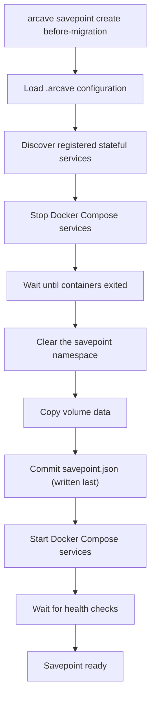
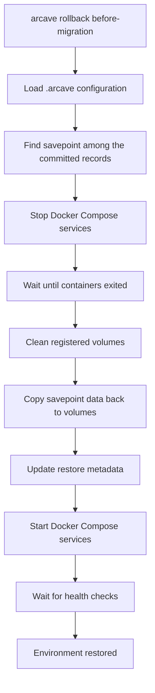

# Implementation Spec

## Project Overview

arcave is a local environment lifecycle manager for stateful Docker Compose applications.

Modern development workflows make it easy to version source code, but stateful services such as PostgreSQL, MySQL,
Redis, MongoDB, and Kafka remain difficult to manage. Developers frequently need to experiment with schema migrations,
data transformations, test automation, AI agents, and application changes that modify persistent state. Recovering from
mistakes often requires recreating environments, reloading datasets, or manually restoring backups.

arcave introduces savepoints and fast environment recovery for Docker Compose projects, allowing developers and AI agents to
safely iterate on stateful systems.

A savepoint captures a consistent snapshot of an environment at a specific moment in time. If an experiment, migration,
or code change fails, the environment can be quickly restored to a previously known state.

arcave is designed around the emerging agent-driven development workflow, where AI agents continuously modify code, execute
migrations, run tests, and interact with databases as part of an iterative development cycle.

A typical agent development loop looks like:

1. Create a savepoint.
2. Apply code or schema changes.
3. Execute tests and validation.
4. If successful, continue to the next iteration.
5. If validation fails, rollback to the previous savepoint.

This enables rapid experimentation without the cost of recreating environments or manually restoring databases.

arcave can be used directly through its CLI:

```bash
arcave savepoint create before-migration
arcave rollback before-migration
```

or through the arcave MCP server, allowing AI agents to invoke savepoint, restore, clone, and environment management
operations as native tools.

By providing a lightweight state management layer for Docker Compose environments, arcave enables both developers and AI
agents to safely explore, test, and recover stateful application changes with minimal operational overhead.

The long-term vision is to provide a generic environment state management platform that supports savepoints, rollback,
cloning, branching, and automated recovery workflows across a wide range of databases and stateful services.

---

## Savepoint Process

Here is an example of the savepoint creation workflow:



Pseudo-code for the `arcave savepoint create` command:

```shell
arcave savepoint create before-migration

# 1. Stop services
docker compose stop

# 2. Clear the namespace, dropping anything a crashed run left behind
rm -rf .arcave/savepoints/myapp/1780335122

# 3. Copy registered volumes
cp -a pgdata .arcave/savepoints/myapp/1780335122/postgres
cp -a redisdata .arcave/savepoints/myapp/1780335122/redis

# 4. Commit the savepoint — the record is written LAST
write .arcave/savepoints/myapp/1780335122/savepoint.json

# 5. Start services
docker compose up -d

# 6. Wait healthy
```

The record is the commit marker. A crash before step 4 leaves volume data that no
record names: `arcave savepoint list` skips it, and it is safe to reclaim. There is no
window in which a savepoint lists without its data.

Removal runs the same steps in reverse, uncommitting first: `savepoint.json` is
deleted before the namespace it lives in, so the only observable states are
"fully present" and "gone".

One store holds everything, a rollback's safety snapshot included: it is an ordinary savepoint, with its own record, marked with the label `arcave-safety-snapshot=true`. The mark is what hides it — `arcave savepoint list` and every scanning selector (`latest`, a name, `--retain-recent`, `--retain-for`, `--before-date`) skip it, while an explicit id reaches it. A rollback deletes its own snapshot on success and after a successful revert; the one left behind by a killed rollback is the last copy of the pre-rollback state, and that asymmetry is the whole reason the record exists. Recovering from it is manual — `arcave savepoint list --include-safety-snapshots` to find the id, `arcave rollback <id>` to apply it, `arcave savepoint remove --ids <id>` to be rid of it. arcave does not finish a rollback it died in the middle of.

---

## Rollback Process



---

## Future Optimization

The current MVP implementation restores an environment by deleting the contents of the active volume and copying data
back from the selected savepoint. This approach is intentionally simple, portable, and easy to validate.

In future versions, the restore process can be optimized by introducing volume-level snapshot backends and volume
swapping. Instead of physically copying data, arcave would switch the active volume reference to a previously created
snapshot or clone. This would reduce restore time from being proportional to dataset size to being nearly instantaneous,
limited primarily by container restart and health check time.

The restore workflow would evolve from:

`Stop Services → Delete Data → Copy Snapshot → Start Services`

to:

`Stop Services → Swap Volume → Start Services`

The architecture should therefore be designed around pluggable snapshot backends, allowing the MVP copy-based
implementation to be replaced later with more advanced technologies such as rsync-based snapshots, filesystem-level
copy-on-write clones, or storage-native snapshot mechanisms without changing the user-facing workflow.

---

## arcave CLI UX

### Project Initialization

#### arcave doctor

Analyzes the current Docker Compose project and validates whether it is compatible with arcave savepoint and restore
workflows.

The command performs static analysis of the project and reports potential issues, warnings, and recommendations.

The command never modifies project files.

```bash
arcave doctor
```

##### Checks

###### Project Validation

- Docker Compose file exists.
- Compose file can be parsed successfully.
- Project contains services.

###### Stateful Service Detection

Detects known stateful services:

- PostgreSQL
- MySQL
- MariaDB
- Redis
- MongoDB
- Kafka
- Elasticsearch

and reports whether arcave can manage their persistent state.

###### Volume Validation

Checks:

- Named volume is configured.
- Bind mounts are used.
- Anonymous volumes are used.
- Stateful services store data inside container filesystem.

###### Health Check Validation

Checks whether services define Docker health checks.

Missing health checks are reported as warnings because arcave restore operations rely on service readiness detection.

###### Service Dependency Validation

Analyzes:

- `depends_on` relationships
- shared networks
- environment variables

and identifies services that may continue writing into stateful systems.

###### arcave Initialization State

Checks:

- `.arcave` directory exists
- `config.yaml` exists, and its `version` is one arcave speaks
- the savepoint store is reachable and holds no legacy `manifest.json`

###### Storage Validation

Checks:

- Snapshot directory accessibility
- Available disk space
- Estimated snapshot size

##### Output Format

All output is returned as JSON.

Example:

```json
{
  "project": {
    "name": "myapp"
  },
  "status": "warning",
  "issues": [
    {
      "severity": "warning",
      "service": "postgres",
      "code": "MISSING_PERSISTENT_VOLUME",
      "message": "PostgreSQL service does not use a named persistent volume.",
      "suggested_fix": {
        "service": "postgres",
        "volume": "postgres_data",
        "mount_path": "/var/lib/postgresql/data"
      }
    },
    {
      "severity": "warning",
      "service": "postgres",
      "code": "MISSING_HEALTHCHECK",
      "message": "PostgreSQL service does not define a health check."
    },
    {
      "severity": "info",
      "service": "app",
      "code": "WRITER_DEPENDENCY_DETECTED",
      "message": "Application service appears to depend on PostgreSQL."
    }
  ],
  "summary": {
    "errors": 0,
    "warnings": 2,
    "infos": 1
  }
}
```

##### Exit Codes

```text
0  healthy
1  warnings detected
2  errors detected
```

##### Integration with arcave fix

Doctor never changes anything.

Suggested fixes can be automatically applied later using:

```bash
arcave fix
```

which consumes doctor recommendations and updates the project configuration accordingly.

---

#### arcave recommend

Reports the persistent volumes the project's services should mount and do not — state that lives inside the container
filesystem and would therefore be silently lost by a savepoint/rollback cycle.

It is the shipped, narrowed form of the `Volume Validation` check above: one question, one output shape, no severity
model. It is strictly read-only — it parses the compose files and the recommendation catalog and reaches for neither the
savepoint store, nor the Docker daemon, nor the project lock — so it is safe to run at any time, including while another
arcave command is working.

```bash
arcave recommend
arcave recommend -f docker-compose.yaml -f docker-compose.override.yaml
arcave recommend --recommender-file ./team-arc.yaml --recommender-file ./my-arc.yaml
```

##### Flags

```text
-f, --file                Docker Compose file (repeatable). Defaults to the project's configured
                          compose files; with an explicit -f the command needs no arcave project at all.
    --recommender-file    A recommendation catalog merged over the built-in one (repeatable;
                          several are merged left to right).
```

##### How a recommendation is produced

Each service's image is reduced to its repository — no tag, no digest, no `docker.io/library/` prefix, so `postgres:16`
becomes `postgres` and `ghcr.io/org/pg:1` becomes `org/pg` — and looked up in the catalog. Every catalog volume the
service does not already mount something persistent at becomes one recommendation. A named volume, a bind mount and an
anonymous volume all count as coverage; a tmpfs mount does not, since it persists nothing. A service that only builds,
or whose image reference will not parse, is skipped.

##### Registries

arcave assumes no default registry and no single one: the domain is dropped from every image before matching, so a
project pulling from Docker Hub, a corporate registry and ghcr.io in the same compose file matches all of them against
one catalog.

```text
postgres:16                                          -> postgres                       (built-in match)
registry.corp.local/postgres:16                      -> postgres                       (built-in match)
localhost:5000/redis:7                               -> redis                          (built-in match)
docker.elastic.co/elasticsearch/elasticsearch:8.13.0 -> elasticsearch/elasticsearch    (built-in match)
ghcr.io/myorg/mydb:1                                 -> myorg/mydb                     (no entry)
mycorp.jfrog.io/docker-remote/library/postgres:16    -> docker-remote/library/postgres (no entry)
```

Docker Hub is special-cased in exactly one respect: it is the only registry that injects a `library/` namespace nobody
writes, so that prefix is stripped.

The last two lines are the two ways a match is missed, and they are different problems:

- A **private image** is missed on purpose — arcave cannot know what someone's own image stores. Describe it in a
  catalog of your own.
- A **pull-through mirror that prefixes the path** (Artifactory, Nexus, Harbor) yields a genuinely different key. Map it
  onto the entry it belongs to with an alias.

Both are handled by the same file, which a team commits to its repository and passes with `--recommender-file`:

```yaml
- image: postgres                              # merged into the built-in entry
  aliases:
    - docker-remote/library/postgres           # the mirror prefix your registry adds
- image: myorg/mydb                            # your own image
  volumes:
    - /var/lib/mydb
```

arcave deliberately does *not* guess here by trimming leading path segments until something matches: that would advise
on anyone's own `ghcr.io/myorg/redis`, and the catalog is additive, so a false positive could not be taken back. An
entry cannot be pinned to a registry either — two registries serving different layouts under the same path would be
indistinguishable — which no known setup needs.

##### The ARC catalog

The Arcave Recommender Config is a YAML list. arcave ships one compiled into the binary; each `--recommender-file` is
merged over the result so far, keyed on the exact image string — a matching entry gains the file's aliases and volumes
(deduplicated, earlier order first), a new image is appended. Nothing is ever removed, and an alias a later file
reassigns wins over the earlier mapping, so a personal catalog can layer over a team one and both over arcave's own.

```yaml
- image: postgres            # normalized repository, the match key
  aliases:                   # images storing the same state in the same places
    - pgvector/pgvector
    - timescale/timescaledb
  volumes:                   # container paths that state lives at
    - /var/lib/postgresql/data

- image: minio/minio
  volumes:
    - /data
```

An entry without an `image`, or an unknown key, is an error naming the file and the entry's index.

##### Output

A JSON array on stdout, empty (`[]`, never `null`) when there is nothing to recommend. Services are ordered by name and
volumes in catalog order, so the output is stable across runs.

```json
[
  {
    "service": "db",
    "image": "postgres:16",
    "volume": "/var/lib/postgresql/data",
    "operation": "add-volume",
    "hash": "68cf83ec338db99fb410469421d5623bc116ea567d598e65e0e6d76603566892"
  }
]
```

`image` is the compose file's value verbatim, tag and all — not the normalized repository the catalog was matched on.

`hash` identifies the recommendation, not the run: it is the lowercase hex sha256 of

```text
service + "|" + image + "|" + volume + "|" + operation
```

so the same finding hashes identically on every invocation and a caller can suppress one it has already seen or acted
on. Because `image` participates, bumping the image tag produces a new hash — the advice is about that image.

`operation` names what to do. `add-volume` is the only value today; it exists as a field so a future `arcave fix` can
dispatch on it, and so a second kind of recommendation needs no change to the wire shape.

##### Exit Codes

```text
0  nothing to recommend (the array is empty)
1  there are recommendations, or the command failed
```

The status is a finding, not an error: the JSON array is still written to stdout, and nothing is printed to stderr.
A caller that needs to tell "has advice" from "failed" reads stdout — a failure produces no JSON.

---

#### arcave init

Initializes arcave metadata for the current project.

```bash
arcave init
```

Behavior:

- Creates `.arcave` directory.
- Discovers stateful services.
- Creates initial configuration.
- Optionally adds `.arcave` to `.gitignore`.

Result:

```text
.arcave/
├── config.yaml                          # written by `arcave init`
├── lock                                 # flock target; serialises mutating workflows
└── savepoints/<project-name>/           # the savepoint store, created by `arcave init`
    └── <savepoint-id>/                  # one self-contained namespace per savepoint
        ├── savepoint.json               # the record — written last, the commit marker
        └── <service>/<mount-path>/data.tar
```

Each savepoint is one self-contained directory: its record and every archive it
names live under the same namespace, so `cp -r <id>/` moves the whole savepoint.
The record sits at the root of the store's namespace rather than in `.arcave/`, so
pointing `storage.directory.path` at remote storage carries the records along with
the data they describe.

`config.yaml` is the one file arcave reads through the OS rather than through the
storage backend — it is what says where the storage backend points.

```yaml
version: 1
project:
  name: myapp
  compose_files: [docker-compose.yml]
docker:
  host: unix:///var/run/docker.sock     # "" => read the environment
storage:
  type: directory                       # directory | s3 (future)
  directory: {path: .arcave/savepoints/myapp}
snapshot:
  backend: fullcopy
log: {level: info, format: text}
```

`storage` is a tagged union: `type` names the arm, and that arm must be present.
Unknown keys are an error, not a value silently ignored. A config file without a
`version`, or with one arcave does not speak, is refused with a message naming
`arcave init --override` as the fix — arcave never rewrites it silently, since that would
clobber a path the user set deliberately.

A savepoint store may not be `/`, a shallow system directory, `$HOME`, or any
ancestor of the project.

---

### Savepoint Management

#### arcave savepoint create

Creates a new environment savepoint.

```bash
arcave savepoint create \
    [--name before-migration] \
    [--description "Before applying migration 2026_001"]
```

Behavior:

- Stops project services.
- Creates snapshots of all registered stateful service volumes.
- Restarts services.
- Waits for health checks.

##### What a savepoint covers

The unit of backup is the **volume**, not the mount:

- Every named volume the project declares — including `external: true` ones, and including ones no service mounts.
- Every bind mount and every anonymous volume, one unit per service and target. A named volume three services mount is one unit, captured once.
- Mounts that are not persistent data are skipped, each reported with its reason: `tmpfs`, `npipe`, `image` and `cluster`.

A volume is addressed directly — a named volume by its docker name, a bind by its host path — and read and written through a throwaway container of arcave's own. The project's own containers need not be running, or exist at all. The one exception is an **anonymous volume**: its docker name is created per container, so arcave has to ask the daemon through that service's container, and a create or rollback fails if it is gone.

Two things follow that a user with a `subpath:` mount will not expect:

- A volume mounted through `subpath:` is captured **whole**. The subpath is a property of that one mount, and the daemon does not report it back at all — only the compose file knows about it.
- **A rollback therefore restores the whole volume**, not the subdirectory the service sees. Everything else in that volume goes back to its savepoint state too.

A named volume that does not exist on the daemon is an **error**, not a skip: an empty capture would silently wipe live data at the next rollback. Bring the project up once (`docker compose up`) to create the volumes it declares.

Every savepoint receives a unique immutable identifier — a Unix timestamp integer:

```text
1780335122
```

Metadata stored in `<savepoint-id>/savepoint.json`:

```json
{
  "id": "1780335122",
  "name": "before-migration",
  "description": "Before applying migration 2026_001",
  "created_at": "2026-06-01T19:41:12.123456789Z"
}
```

---

#### arcave savepoint list

Lists available savepoints.

```bash
arcave savepoint list
arcave savepoint list --include-safety-snapshots
```

Options:

```text
--include-safety-snapshots   Also list the safety snapshots a rollback takes of the live state.
                           Hidden by default: one exists only while a rollback runs. One that
                           outlived its rollback is that rollback's last copy of the
                           pre-rollback state, and can be rolled back to by id.
```

Output:

```json
[
  {
    "id": "1780335122",
    "name": "before-migration",
    "description": "Before applying migration 2026_001",
    "created_at": "2026-06-01T19:41:12.123456789Z"
  }
]
```

---

#### arcave savepoint remove

Removes savepoints.

```bash
arcave savepoint remove --retain-recent 10
arcave savepoint remove --retain-for 30d
arcave savepoint remove --before-date 2026-01-01T00:00:00Z
arcave savepoint remove --dry-run --retain-for 14d
```

Options:

```text
--before-date string   Delete savepoints older than the specified RFC3339Nano timestamp.
--dry-run              Show savepoints that would be deleted without deleting them.
--retain-for duration  Retain savepoints for the specified duration. Example: 1w2d3h4m5s
--retain-recent int    Retain the most recent N savepoints.
```

---

### Environment Recovery

#### arcave rollback

Restores the environment to a specified savepoint.

```bash
arcave rollback latest
arcave rollback 1780335122
arcave rollback before-migration
```

The argument names the savepoint in one of three ways, and which one it is decided by the token itself: `latest` is reserved, a run of decimal digits is an **id** (that being exactly what a savepoint id is), and anything else is a **name**. An id is exact and never falls back to a name — `arcave rollback 1780335122` will not resolve to a savepoint merely *called* `1780335122` — and it is the only form that reaches a safety snapshot. A name matching several savepoints is an error listing the candidate ids, never a silent guess.

Behavior:

- Stops project services.
- Takes a safety snapshot of the live state, named `safety-snapshot-<id of the savepoint being restored>`, so one left behind by a killed rollback says which savepoint it was undoing.
- Restores all registered stateful service volumes.
- Starts project services.
- Waits for health checks.
- Deletes the safety snapshot, unless replaying it failed too — the one case where it is the last copy of the pre-rollback state.

---

### Project Status

#### arcave status

Displays project information and storage usage.

```bash
arcave status
```

Output:

```json
{
  "project": {
    "name": "myapp"
  },
  "stateful_services": [
    "postgres",
    "redis"
  ],
  "savepoints": {
    "total": 24,
    "latest": {
      "name": "before-migration",
      "id": "2026-06-01T19:41:12.123456789Z",
      "created_at": "2026-06-01T19:41:12.123456789Z"
    }
  },
  "storage": {
    "used_bytes": 9019431321,
    "used_human_readable": "8.4 GB"
  }
}
```

---

### Agent Integration

#### arcave mcp

Starts the arcave MCP server.

```bash
arcave mcp
```

Provides AI agents with native tools:

- `create_savepoint`
- `list_savepoints`
- `rollback`
- `status`

This enables agent-driven development workflows where agents can safely create savepoints before modifying application
state and automatically rollback when validation fails.

---

#### MCP Implementation Architecture

##### Transport

The MCP server uses **stdio transport** (JSON-RPC 2.0 over stdin/stdout). The agent host (e.g. Claude Desktop,
Claude Code) launches `arcave mcp` as a child process and communicates with it over its standard streams. No HTTP server,
no port, no network configuration required.

```
Agent host process
      │
      │  stdin / stdout  (JSON-RPC 2.0)
      ▼
 arcave mcp process
      │
      │  direct Go calls
      ▼
  GMService interface
      │
      ├── internal/service/core            (savepoint / rollback logic)
      ├── internal/client/{compose,docker} (docker compose interaction)
      └── internal/repository/{savepoint,config}
                                           (savepoint records, config.yaml I/O)
```

##### Internal Architecture

MCP tool handlers do **not** shell out to the `arcave` binary. Instead, both the CLI commands (`internal/cmd`) and
the MCP server (`internal/mcp`) call a shared `GMService` interface defined in `internal/service`.

This keeps business logic in one place and avoids subprocess overhead, output parsing, and process management
complexity inside the MCP layer.

```go
// internal/service/service.go
type GMService interface {
    CreateSavepoint(ctx context.Context, req CreateSavepointRequest) (*SavepointResult, error)
    ListSavepoints(ctx context.Context) ([]SavepointMeta, error)
    Rollback(ctx context.Context, savepointID string) (*RollbackResult, error)
    Status(ctx context.Context) (*StatusResult, error)
}
```

CLI commands instantiate `GMService` and call it directly. The MCP server does the same — it is a thin transport
adapter, not a separate execution path.

##### MCP Tools

###### create_savepoint

Creates a new environment savepoint.

Input schema:

```json
{
  "name":        { "type": "string", "description": "Human-readable savepoint name" },
  "description": { "type": "string", "description": "Optional description" }
}
```

Output: savepoint metadata JSON (same schema as `arcave savepoint create`).

---

###### list_savepoints

Lists all available savepoints.

Input schema: none.

Output: savepoint list JSON (same schema as `arcave savepoint list`).

---

###### rollback

Restores the environment to a specified savepoint.

Input schema:

```json
{
  "savepoint_id": { "type": "string", "description": "Savepoint ID or 'latest'" }
}
```

Output: rollback result JSON.

---

###### status

Returns project status and storage usage.

Input schema: none.

Output: status JSON (same schema as `arcave status`).

---

##### MCP Server Registration (claude_desktop_config.json / .mcp.json)

```json
{
  "mcpServers": {
    "arcave": {
      "command": "arcave",
      "args": ["mcp"]
    }
  }
}
```

The agent host starts `arcave mcp` in the project directory so that arcave resolves `.arcave/config.yaml` relative to the
working directory, matching the same behaviour as the CLI.
