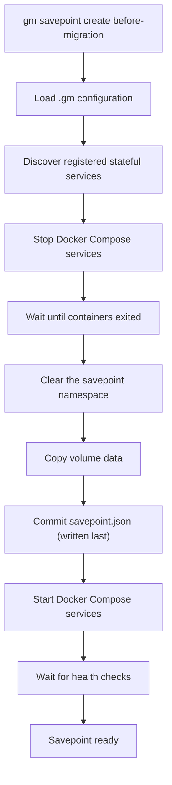
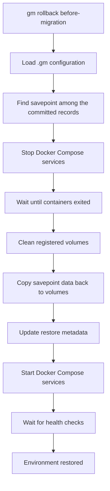

# Implementation Spec

## Project Overview

GM is a local environment lifecycle manager for stateful Docker Compose applications.

Modern development workflows make it easy to version source code, but stateful services such as PostgreSQL, MySQL,
Redis, MongoDB, and Kafka remain difficult to manage. Developers frequently need to experiment with schema migrations,
data transformations, test automation, AI agents, and application changes that modify persistent state. Recovering from
mistakes often requires recreating environments, reloading datasets, or manually restoring backups.

GM introduces savepoints and fast environment recovery for Docker Compose projects, allowing developers and AI agents to
safely iterate on stateful systems.

A savepoint captures a consistent snapshot of an environment at a specific moment in time. If an experiment, migration,
or code change fails, the environment can be quickly restored to a previously known state.

GM is designed around the emerging agent-driven development workflow, where AI agents continuously modify code, execute
migrations, run tests, and interact with databases as part of an iterative development cycle.

A typical agent development loop looks like:

1. Create a savepoint.
2. Apply code or schema changes.
3. Execute tests and validation.
4. If successful, continue to the next iteration.
5. If validation fails, rollback to the previous savepoint.

This enables rapid experimentation without the cost of recreating environments or manually restoring databases.

GM can be used directly through its CLI:

```bash
gm savepoint create before-migration
gm rollback before-migration
```

or through the GM MCP server, allowing AI agents to invoke savepoint, restore, clone, and environment management
operations as native tools.

By providing a lightweight state management layer for Docker Compose environments, GM enables both developers and AI
agents to safely explore, test, and recover stateful application changes with minimal operational overhead.

The long-term vision is to provide a generic environment state management platform that supports savepoints, rollback,
cloning, branching, and automated recovery workflows across a wide range of databases and stateful services.

---

## Savepoint Process

Here is an example of the savepoint creation workflow:



Pseudo-code for the `gm savepoint create` command:

```shell
gm savepoint create before-migration

# 1. Stop services
docker compose stop

# 2. Clear the namespace, dropping anything a crashed run left behind
rm -rf .gm/savepoints/myapp/1780335122

# 3. Copy registered volumes
cp -a pgdata .gm/savepoints/myapp/1780335122/postgres
cp -a redisdata .gm/savepoints/myapp/1780335122/redis

# 4. Commit the savepoint — the record is written LAST
write .gm/savepoints/myapp/1780335122/savepoint.json

# 5. Start services
docker compose up -d

# 6. Wait healthy
```

The record is the commit marker. A crash before step 4 leaves volume data that no
record names: `gm savepoint list` skips it, and it is safe to reclaim. There is no
window in which a savepoint lists without its data.

Removal runs the same steps in reverse, uncommitting first: `savepoint.json` is
deleted before the namespace it lives in, so the only observable states are
"fully present" and "gone".

---

## Rollback Process



---

## Future Optimization

The current MVP implementation restores an environment by deleting the contents of the active volume and copying data
back from the selected savepoint. This approach is intentionally simple, portable, and easy to validate.

In future versions, the restore process can be optimized by introducing volume-level snapshot backends and volume
swapping. Instead of physically copying data, GM would switch the active volume reference to a previously created
snapshot or clone. This would reduce restore time from being proportional to dataset size to being nearly instantaneous,
limited primarily by container restart and health check time.

The restore workflow would evolve from:

`Stop Services → Delete Data → Copy Snapshot → Start Services`

to:

`Stop Services → Swap Volume → Start Services`

The architecture should therefore be designed around pluggable snapshot backends, allowing the MVP copy-based
implementation to be replaced later with more advanced technologies such as rsync-based snapshots, filesystem-level
copy-on-write clones, or storage-native snapshot mechanisms without changing the user-facing workflow.

---

## GM CLI UX

### Project Initialization

#### gm doctor

Analyzes the current Docker Compose project and validates whether it is compatible with GM savepoint and restore
workflows.

The command performs static analysis of the project and reports potential issues, warnings, and recommendations.

The command never modifies project files.

```bash
gm doctor
```

##### Checks

###### Project Validation

- Docker Compose file exists.
- Compose file can be parsed successfully.
- Project contains services.

###### Stateful Service Detection

Detects known stateful services:

- PostgreSQL
- MySQL
- MariaDB
- Redis
- MongoDB
- Kafka
- Elasticsearch

and reports whether GM can manage their persistent state.

###### Volume Validation

Checks:

- Named volume is configured.
- Bind mounts are used.
- Anonymous volumes are used.
- Stateful services store data inside container filesystem.

###### Health Check Validation

Checks whether services define Docker health checks.

Missing health checks are reported as warnings because GM restore operations rely on service readiness detection.

###### Service Dependency Validation

Analyzes:

- `depends_on` relationships
- shared networks
- environment variables

and identifies services that may continue writing into stateful systems.

###### GM Initialization State

Checks:

- `.gm` directory exists
- `config.yaml` exists, and its `version` is one GM speaks
- the savepoint store is reachable and holds no legacy `manifest.json`

###### Storage Validation

Checks:

- Snapshot directory accessibility
- Available disk space
- Estimated snapshot size

##### Output Format

All output is returned as JSON.

Example:

```json
{
  "project": {
    "name": "myapp"
  },
  "status": "warning",
  "issues": [
    {
      "severity": "warning",
      "service": "postgres",
      "code": "MISSING_PERSISTENT_VOLUME",
      "message": "PostgreSQL service does not use a named persistent volume.",
      "suggested_fix": {
        "service": "postgres",
        "volume": "postgres_data",
        "mount_path": "/var/lib/postgresql/data"
      }
    },
    {
      "severity": "warning",
      "service": "postgres",
      "code": "MISSING_HEALTHCHECK",
      "message": "PostgreSQL service does not define a health check."
    },
    {
      "severity": "info",
      "service": "app",
      "code": "WRITER_DEPENDENCY_DETECTED",
      "message": "Application service appears to depend on PostgreSQL."
    }
  ],
  "summary": {
    "errors": 0,
    "warnings": 2,
    "infos": 1
  }
}
```

##### Exit Codes

```text
0  healthy
1  warnings detected
2  errors detected
```

##### Integration with gm fix

Doctor never changes anything.

Suggested fixes can be automatically applied later using:

```bash
gm fix
```

which consumes doctor recommendations and updates the project configuration accordingly.

---

#### gm init

Initializes GM metadata for the current project.

```bash
gm init
```

Behavior:

- Creates `.gm` directory.
- Discovers stateful services.
- Creates initial configuration.
- Optionally adds `.gm` to `.gitignore`.

Result:

```text
.gm/
├── config.yaml                          # written by `gm init`
├── lock                                 # flock target; serialises mutating workflows
└── savepoints/<project-name>/           # the savepoint store, created by `gm init`
    └── <savepoint-id>/                  # one self-contained namespace per savepoint
        ├── savepoint.json               # the record — written last, the commit marker
        └── <service>/<mount-path>/data.tar
```

Each savepoint is one self-contained directory: its record and every archive it
names live under the same namespace, so `cp -r <id>/` moves the whole savepoint.
The record sits at the root of the store's namespace rather than in `.gm/`, so
pointing `storage.directory.path` at remote storage carries the records along with
the data they describe.

`config.yaml` is the one file GM reads through the OS rather than through the
storage backend — it is what says where the storage backend points.

```yaml
version: 1
project:
  name: myapp
  compose_files: [docker-compose.yml]
docker:
  host: unix:///var/run/docker.sock     # "" => read the environment
storage:
  type: directory                       # directory | s3 (future)
  directory: {path: .gm/savepoints/myapp}
snapshot:
  backend: fullcopy
log: {level: info, format: text}
```

`storage` is a tagged union: `type` names the arm, and that arm must be present.
Unknown keys are an error, not a value silently ignored. A config file without a
`version`, or with one GM does not speak, is refused with a message naming
`gm init --override` as the fix — GM never rewrites it silently, since that would
clobber a path the user set deliberately.

A savepoint store may not be `/`, a shallow system directory, `$HOME`, or any
ancestor of the project.

---

### Savepoint Management

#### gm savepoint create

Creates a new environment savepoint.

```bash
gm savepoint create \
    [--name before-migration] \
    [--description "Before applying migration 2026_001"]
```

Behavior:

- Stops project services.
- Creates snapshots of all registered stateful service volumes.
- Restarts services.
- Waits for health checks.

Every savepoint receives a unique immutable identifier — a Unix timestamp integer:

```text
1780335122
```

Metadata stored in `<savepoint-id>/savepoint.json`:

```json
{
  "id": "1780335122",
  "name": "before-migration",
  "description": "Before applying migration 2026_001",
  "created_at": "2026-06-01T19:41:12.123456789Z"
}
```

---

#### gm savepoint list

Lists available savepoints.

```bash
gm savepoint list
```

Output:

```json
[
  {
    "id": "1780335122",
    "name": "before-migration",
    "description": "Before applying migration 2026_001",
    "created_at": "2026-06-01T19:41:12.123456789Z"
  }
]
```

---

#### gm savepoint remove

Removes savepoints.

```bash
gm savepoint remove --retain-recent 10
gm savepoint remove --retain-for 30d
gm savepoint remove --before-date 2026-01-01T00:00:00Z
gm savepoint remove --dry-run --retain-for 14d
```

Options:

```text
--before-date string   Delete savepoints older than the specified RFC3339Nano timestamp.
--dry-run              Show savepoints that would be deleted without deleting them.
--retain-for duration  Retain savepoints for the specified duration. Example: 1w2d3h4m5s
--retain-recent int    Retain the most recent N savepoints.
```

---

### Environment Recovery

#### gm rollback

Restores the environment to a specified savepoint.

```bash
gm rollback latest
gm rollback 1780335122
```

Behavior:

- Stops project services.
- Restores all registered stateful service volumes.
- Starts project services.
- Waits for health checks.

---

### Project Status

#### gm status

Displays project information and storage usage.

```bash
gm status
```

Output:

```json
{
  "project": {
    "name": "myapp"
  },
  "stateful_services": [
    "postgres",
    "redis"
  ],
  "savepoints": {
    "total": 24,
    "latest": {
      "name": "before-migration",
      "id": "2026-06-01T19:41:12.123456789Z",
      "created_at": "2026-06-01T19:41:12.123456789Z"
    }
  },
  "storage": {
    "used_bytes": 9019431321,
    "used_human_readable": "8.4 GB"
  }
}
```

---

### Agent Integration

#### gm mcp

Starts the GM MCP server.

```bash
gm mcp
```

Provides AI agents with native tools:

- `create_savepoint`
- `list_savepoints`
- `rollback`
- `status`

This enables agent-driven development workflows where agents can safely create savepoints before modifying application
state and automatically rollback when validation fails.

---

#### MCP Implementation Architecture

##### Transport

The MCP server uses **stdio transport** (JSON-RPC 2.0 over stdin/stdout). The agent host (e.g. Claude Desktop,
Claude Code) launches `gm mcp` as a child process and communicates with it over its standard streams. No HTTP server,
no port, no network configuration required.

```
Agent host process
      │
      │  stdin / stdout  (JSON-RPC 2.0)
      ▼
 gm mcp process
      │
      │  direct Go calls
      ▼
  GMService interface
      │
      ├── internal/service/core            (savepoint / rollback logic)
      ├── internal/client/{compose,docker} (docker compose interaction)
      └── internal/repository/{savepoint,config}
                                           (savepoint records, config.yaml I/O)
```

##### Internal Architecture

MCP tool handlers do **not** shell out to the `gm` binary. Instead, both the CLI commands (`internal/cmd`) and
the MCP server (`internal/mcp`) call a shared `GMService` interface defined in `internal/service`.

This keeps business logic in one place and avoids subprocess overhead, output parsing, and process management
complexity inside the MCP layer.

```go
// internal/service/service.go
type GMService interface {
    CreateSavepoint(ctx context.Context, req CreateSavepointRequest) (*SavepointResult, error)
    ListSavepoints(ctx context.Context) ([]SavepointMeta, error)
    Rollback(ctx context.Context, savepointID string) (*RollbackResult, error)
    Status(ctx context.Context) (*StatusResult, error)
}
```

CLI commands instantiate `GMService` and call it directly. The MCP server does the same — it is a thin transport
adapter, not a separate execution path.

##### MCP Tools

###### create_savepoint

Creates a new environment savepoint.

Input schema:

```json
{
  "name":        { "type": "string", "description": "Human-readable savepoint name" },
  "description": { "type": "string", "description": "Optional description" }
}
```

Output: savepoint metadata JSON (same schema as `gm savepoint create`).

---

###### list_savepoints

Lists all available savepoints.

Input schema: none.

Output: savepoint list JSON (same schema as `gm savepoint list`).

---

###### rollback

Restores the environment to a specified savepoint.

Input schema:

```json
{
  "savepoint_id": { "type": "string", "description": "Savepoint ID or 'latest'" }
}
```

Output: rollback result JSON.

---

###### status

Returns project status and storage usage.

Input schema: none.

Output: status JSON (same schema as `gm status`).

---

##### MCP Server Registration (claude_desktop_config.json / .mcp.json)

```json
{
  "mcpServers": {
    "gm": {
      "command": "gm",
      "args": ["mcp"]
    }
  }
}
```

The agent host starts `gm mcp` in the project directory so that GM resolves `.gm/config.yaml` relative to the
working directory, matching the same behaviour as the CLI.
