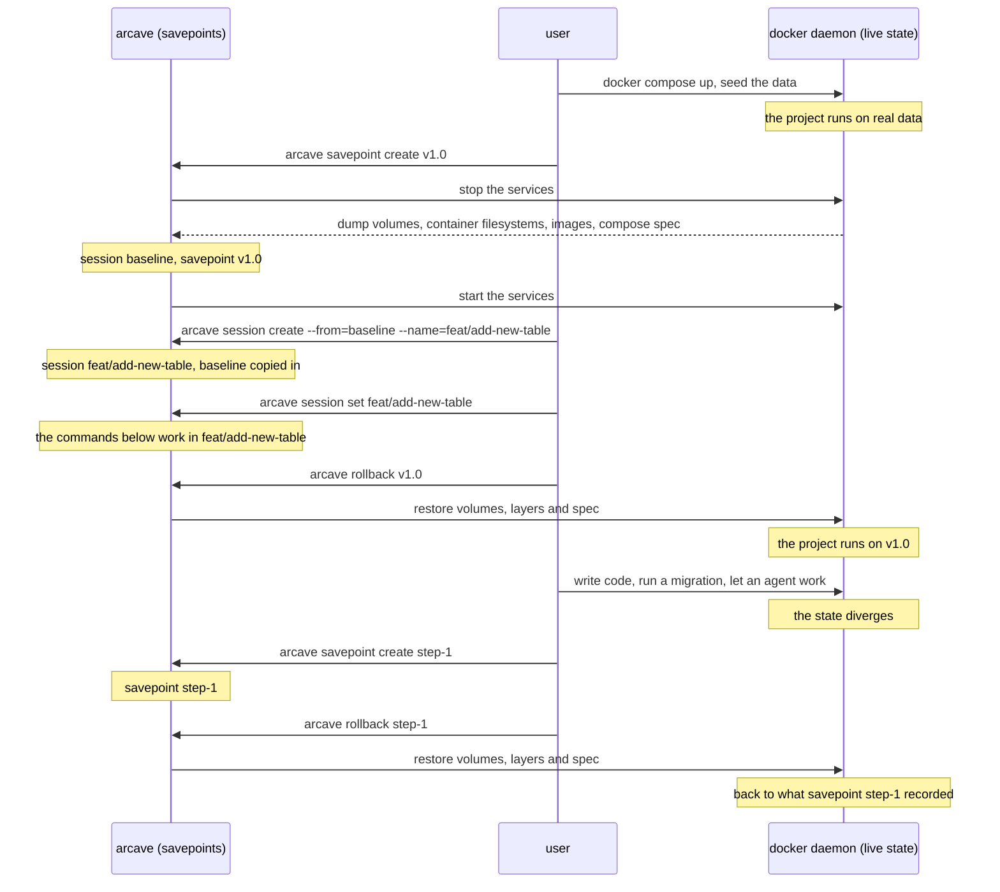

# How arcave works

arcave sits between you and the Docker daemon. It does not install an agent, patch a filesystem, or ask for a copy-on-write volume driver. It stops the project, moves the bytes through the Docker API, and starts the project again.

## You, arcave and the Docker daemon

You are between two things: the savepoints arcave keeps, and the live state your Docker daemon is running. Every arcave command moves state across that gap. `savepoint create` reads the live state into a savepoint. `rollback` writes a savepoint back into the daemon. `session create --from` stays on arcave's side: it copies a session's savepoints into a new session and leaves the daemon alone, so a fork is deployed by a `rollback` inside it.



The fork on that diagram is a **session** — an independent line of savepoints. [Sessions and branching](sessions.md) has that half.

## The project is stopped, on purpose

`savepoint create` and `rollback` stop the project's services before they read or write a byte, and start them again afterwards. Listing, removing savepoints and the `session` commands never touch the running project.

This is the design's central trade. A running database holds state in memory and in files it is midway through writing; copying those files produces a snapshot that may not restore. Stopping the containers first is what makes "consistent" a claim arcave can actually make for every service a compose file might hold — Postgres, MySQL, Redis, Mongo and whatever else — rather than one engine at a time.

The cost is downtime, proportional to the data being moved plus the time your services take to become healthy again.

:::note
`savepoint create` stops the containers, it never removes them: the same containers start again, nothing is recreated, and nothing on the host is touched beyond the data being captured. A rollback is different — it removes the containers and creates them again from the savepoint's spec, see [What a rollback restores](#what-a-rollback-restores).
:::

Two bounds control that window, and both are configurable: [`compose.stop_timeout`](reference/configuration.md#compose) is the least time a container gets to exit on its own before it is killed — a service's `stop_grace_period` raises it — and [`compose.wait_timeout`](reference/configuration.md#compose) is how long arcave waits for health checks after the restart. The stop timeout matters more here than it does to plain `docker compose stop`: arcave captures the volumes the moment the containers are down, so a database killed mid-shutdown is captured mid-shutdown.

## What a savepoint is made of

A savepoint captures four things, and they never overlap.

**The volumes.** Every persistent mount in the project, addressed as a volume rather than as a mount path.

**The writable layer.** Every container's writable layer, committed as an image. `docker commit` excludes the contents of every mount by contract, so the layer capture sees exactly what the volume capture cannot: whatever a service wrote past all of its mounts — a file dropped in `/tmp`, a package installed at runtime, a config the entrypoint rewrote in place.

Data belongs in volumes. The layer capture is what keeps a compose project honest when it is not there.

**The images.** One copy of each distinct image a service's `image:` names, stored once for every savepoint and replica that uses it. An image arcave cannot get from the daemon is recorded with `"stored": false` and a warning; it never fails the savepoint.

**The compose spec.** `project.yaml`, the spec of the project as it was running, which a rollback rebuilds the project from.

With [`writable_layers.backend`](reference/configuration.md#writable_layers) at its default, `dedupcopy`, layers are deduplicated: the data every savepoint shares, such as the image a layer sits on, is stored once. In the record, `writable_layers[].size_bytes` is the committed image's size and `writable_layers[].stored_bytes` is what the capture actually added; `images[]` carries the same two numbers for each image. `fullcopy` stores each layer whole instead.

## What a savepoint covers

The unit of backup is the **volume**, not the mount:

* **Every named volume the daemon reports for the project** — including ones no service mounts, and including `external: true` volumes that some service does mount.
* **Every bind mount**, one unit per service and target.
* **Every anonymous volume**, one unit per replica: each replica has its own.
* A named volume that three services mount is **one** unit, captured once.

Mounts that are not persistent data are skipped, and each skip is reported with its reason: `tmpfs`, `npipe`, `image`, `cluster`, `unknown_type`, and `inherited_from_outside` for a mount a service takes through `volumes_from` from a container outside the project. A mount inherited from another service of the project is captured once, as its source's.

The savepoint's `not_covered` lists everything it does not hold: `mounts` (each with its `reason`), `services_without_volumes`, `killed_containers` — the containers the stop had to kill — `replica_gaps`, `unresolved_images`, and the `writable_layers` and `images` a label left out. It is absent when the savepoint holds everything.

A volume is addressed directly — a named volume by its Docker name, a bind mount by its host path — and read and written through a throwaway container of arcave's own. The project's containers need only *exist*; they do not need to be running.

The one exception is an **anonymous volume**. Its Docker name is generated per container, so arcave has to ask the daemon through that service's container, and a capture fails if the container is gone.

:::warning
A named volume the project declares but the daemon does not have is an **error**, not a skip. An empty capture would silently wipe live data at the next rollback. Bring the project up once (`docker compose up`) so the volumes it declares actually exist.
:::

An external volume that nothing mounts is invisible to arcave: it reads the running project, and only compose's own volumes carry the project label that would reveal it.

Volume data is moved one of two ways, chosen by [`snapshot.backend`](reference/configuration.md#snapshot). `fullcopy` streams each mount through the Docker API. `cdc` writes only the chunks that changed since the last savepoint, so the second savepoint of a project costs a fraction of the first, and a rollback rewrites less.

## What you choose to capture

By default a savepoint takes all of the above. `arcave.*` labels in your compose file change that per service or per volume: leave a service, a mount, a writable layer or an image out, or pick the backend a volume is captured with. The [`capture`](reference/configuration.md#capture) keys in `.arcave/config.yaml` set the defaults per kind — writable layers, images, named, bind and anonymous volumes — so you can steer a running project without recreating it. The most specific setting wins: a volume's own label, then the service's, then the config. A mount left out this way is reported in `not_covered.mounts` with the reason `excluded`.

A label arcave cannot read fails `savepoint create` before anything is stopped. When a unit is captured differently than in the latest savepoint, `savepoint create` warns about it. A rollback restores what the savepoint holds, whatever the labels say now; an anonymous volume the savepoint left out comes back empty. [Capture labels](reference/capture_labels.md) has every label.

## The record is the commit marker

Each savepoint has a directory of its own, and the record inside it — `savepoint.json` — is what makes the savepoint exist. It is written **last**, after everything it names is stored, and deleted **first** when a savepoint is removed. That single ordering rule is what makes the whole thing safe to interrupt:

* A run killed before the record is written leaves data that no record names. `arcave savepoint list` does not show it, and nothing will ever restore it.
* A removal killed after the record is deleted leaves data that no record names — the same harmless state.
* There is **no** window in which a savepoint lists without its data behind it.

The consequence worth internalising: **on any failure the record is zero**. A half-finished capture is garbage no caller may address, so arcave does not repair it, does not resume it, and does not delete it either. It is logged, named, and left for you — a failure path is the worst possible moment to start deleting data.

:::note
If a new savepoint's directory is not empty, arcave **refuses** the create rather than sweeping it. Only an interrupted run can have left objects there, and those objects are the last copy of whatever that run captured. They get named, not deleted.
:::

## The savepoint flow

```text title="arcave savepoint create before-migration"
 1.  Claim the project lock, then the session's lock in the store
 2.  Refuse a name another savepoint already carries
 3.  Read the running project from the daemon, check the Docker version
 4.  Resolve the capture labels and render the compose spec
 5.  Stop the services
 6.  Write heartbeat.json — in progress, kept fresh until the record
 7.  Capture every volume
 8.  Store each image
 9.  Commit each container's writable layer
10.  Write project.yaml — the project's compose spec
11.  Check the session's lock is still this run's, write savepoint.json — the commit
     marker, then mark heartbeat.json done
12.  Start the services and wait for health checks
```

The heartbeat says how the run that wrote a savepoint directory ended; a failed capture marks it failed. [`arcave gc`](reference/cli/gc.md) does not read it: gc holds the session's lock, so a directory without a record is dead whatever its heartbeat says.

Steps 2 through 4 run **while the project is still up**: a taken name, a Docker older than 25, a bad label or a spec arcave cannot render fails without stopping anything. A project with no containers — never started, or taken down with `docker compose down` — has nothing to capture, and `savepoint create` refuses it.

## What a rollback restores

A rollback restores **the project the savepoint recorded**, not the one that is running. A service added since is gone. One removed comes back. A changed image, port, environment variable or healthcheck goes back to what it was. That is why `project.yaml` is committed beside the record: it is what the project is rebuilt from. Replicas come back under the numbers they had, gaps included. A few compose settings do not survive this — see [Limitations](reference/limitations.md#some-compose-settings-do-not-survive-a-rollback).

```text title="arcave rollback before-migration"
 1.  Claim the project lock, then the session's lock in the store
 2.  Resolve the savepoint record
 3.  Refuse if an interrupted rollback is marked
 4.  Read the running project from the daemon, check the Docker version
 5.  Build both backend sets — the savepoint's and the live one
 6.  Load and parse the savepoint's compose spec
 7.  Load the stored writable layers into the daemon
 8.  Stop the services
 9.  Safety snapshot of the live state
10.  Write the inflight marker
11.  Remove containers and networks — volumes are kept
12.  Create the project from the spec, on the restored layers
13.  Rebuild each further replica on its own layer, under its recorded number
14.  Restore every volume
15.  Start the services and wait for health checks
16.  Remove the anonymous volumes the teardown orphaned
17.  Clear the marker, drop the safety snapshot
```

Steps 4 through 7 all run **while the project is still up**, and that is the point of them:

* A backend that cannot be constructed — a missing volume, an unreachable store — fails while the project is still running.
* A savepoint whose compose spec will not load fails before anything is torn down: a rollback that cannot say what to rebuild must not destroy what is there.
* An image archive the daemon will not accept fails there too, and so does a service whose image no registry serves and the daemon no longer has.

Compose gives a service one image, but a savepoint holds a layer per replica, so the first replica is created by compose and every further one is rebuilt on its own layer, under the name and number the savepoint recorded.

Volumes are **kept** when the containers are removed: a volume arcave did not capture has no copy anywhere, so deleting it would be unrecoverable. Only the anonymous volumes a restore replaced are removed afterwards.

After a rollback, a container whose layer was restored runs on an `arcave/…:sp-<savepoint id>` image tag rather than on the image its compose file names. A `docker compose up` from your compose file recreates it on the compose file's image and drops the restored layer; roll back again to get it back.

### A project with no containers

A rollback also works on a compose project that has no containers — one never started here, or taken down with `docker compose down`. There is nothing to stop and nothing live to keep, so it takes a short path: no stop, no safety snapshot, no teardown. It loads the layers, creates the project from the spec, restores the volumes and starts the services.

A named volume the project still owns — one `docker compose down` left behind — is overwritten with a warning. Set [`rollback.leftover_volumes`](reference/configuration.md#rollback) to `refuse` to fail instead, before anything is loaded:

```text
compose project is not running but its volumes survive: myapp_pgdata
```

If this rollback fails, arcave removes what it created, including the volumes the project did not have before. With no safety snapshot to return to, the recovery from an interrupted one is to run the same rollback again.

## The safety snapshot

Before a rollback overwrites anything, it takes an ordinary savepoint of the live state. It is not a separate tier or a separate store — it is a normal savepoint carrying the label `arcave-safety-snapshot`, named `safety-snapshot-<id of the savepoint being restored>`, hidden from `arcave savepoint list` unless you pass [`--include-safety-snapshots`](reference/cli/savepoint_list.md), and rollback-able by id like any other.

If any step past that point fails — a restore error, or services that never become healthy — arcave replays the safety snapshot through the very same backend instances that took it: it loads its layers back, creates the project again as it was, restores its volumes, starts the services, and reports the original error.

:::note
The revert runs on a context that ignores cancellation, with its own 10-minute budget. The Ctrl-C that aborted your rollback must not tear down the revert that is trying to save your environment.
:::

The safety snapshot is deleted when the rollback succeeds, and when a revert succeeds. It is **kept** when the revert itself fails — at that point it is the last copy of your pre-rollback state, and its id is printed.

With the `cdc` backend the safety capture is an increment in the same per-volume repository, on the same host and the same path, which is exactly what restic picks a parent by. The undo therefore costs almost nothing.

## The interrupted-rollback marker

A rollback writes `.arcave/inflight.json` before its first destructive write — the teardown — and clears it once the environment is consistent again. The marker carries the phase it died in, because the remedy differs, along with the savepoint being restored and the safety snapshot that undoes it.

| Phase | How far it got |
|---|---|
| `recreating` | From the teardown until the containers exist again. The volumes are still untouched. |
| `restoring` | Restoring volumes. The environment is partially overwritten. |
| `restore-done` | Volumes restored, but the project never came up cleanly. |
| `inconsistent` | The automatic revert itself failed. The safety snapshot is retained. |

While a marker stands, the next mutating workflow is **refused** — with one exception, the remedy, which is allowed through: a rollback to that marker's own safety snapshot, or, for a rollback of a project with no containers, which took no safety snapshot, the same rollback again.

The marker is cleared *before* the safety snapshot is dropped, so a failed clear can never leave a marker pointing at a snapshot that no longer exists.

arcave does not finish a rollback it died in the middle of. Recovery is explicit and yours to drive — see [Troubleshooting](reference/troubleshooting.md#an-interrupted-rollback).

## One project at a time

Every command that changes something — `savepoint create`, `rollback`, `savepoint remove`, and `session create`, `remove`, `set` and `unset` — holds a non-blocking file lock on `.arcave/lock`, bound to the project root. A second such run against the same project fails immediately rather than queuing behind the first: two workflows interleaving stop, capture and start on one compose project has no correct outcome. Commands that only read — `savepoint list`, `session list`, `session current` and `savepoint remove --dry-run` — take no lock and are never refused.

## One session at a time across hosts

`.arcave/lock` is visible only on its own machine, while a store on s3, Azure or SFTP can be shared by several. So `savepoint create`, `rollback`, `savepoint remove`, `session create --from` (on the source session), `session remove` and `arcave gc` also hold the session's lock in the store, `sessions/<session>.lock.json`, for as long as they run:

* A command that finds the lock held **waits up to 60 seconds** for it to be freed, then fails naming the holder: its operation, host and pid.
* The holder renews the lock every few seconds. A lock nobody renews for 30 seconds — its holder crashed or lost the store — is taken over; the holder itself stops before then.
* Before it commits — `savepoint.json`, `session.json` — or removes anything, a command checks the lock is still its own, and fails if it is not.

A command that only reads takes no session lock.

## Related docs

* [Concepts](concepts.md) — the vocabulary used above.
* [Getting started](getting_started.md) — run the flow yourself.
* [Configuration](reference/configuration.md) — the bounds and backends named here.
* [Storage layout](reference/storage_layout.md) — where the captures are written, if you need to look.
* [Limitations](reference/limitations.md) — where this design stops.
