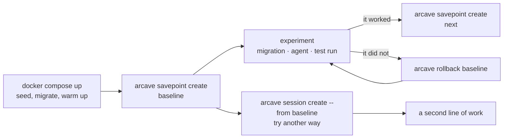

# About arcave

## Ephemeral environments for your Docker Compose stack

Your code is versioned. The state your stack accumulates is not — and that asymmetry is why a bad migration costs an afternoon.

**arcave** gives a Docker Compose stack the semantics you already have for code: save the whole state, come back to it, and branch off any saved point. Not the source tree — the live environment underneath it. Volumes, container filesystems, and the shape of the stack itself.

**It runs on the Docker you already have.** No ZFS, no copy-on-write filesystem, no storage appliance, no daemon to reconfigure. Two things: Docker, and the arcave binary.

**Any stack.** Postgres, MySQL, Kafka, Redis, MinIO, your own services — whatever is in your compose file. There is no allowlist and no per-database plugin, because arcave reads the stack your daemon is running rather than guessing at what the services are.

Bring the stack up, get it to a production-like state with real data, save it — and come back to that state in seconds instead of rebuilding it. Try a migration, an experiment, an agent session; when it goes wrong, go back. People and agents do the same thing at different speeds.

```shell title="The whole idea"
arcave savepoint create before-migration
# ...run the migration, the test suite, the agent...
arcave rollback before-migration
```



## What a savepoint holds

Three things, and they do not overlap:

* **Volumes and mounts** — named volumes, bind mounts and anonymous volumes, for every service in the project. A named volume three services share is captured once.
* **Container filesystem** — what a service wrote *outside* all of its mounts comes back with everything else.
* **Stack topology** — the shape of the stack itself, so a rollback rebuilds the services, images, ports and networks the savepoint recorded, not the ones running now.

The stack is stopped while the savepoint is taken, so nothing is captured mid-write and a database comes back without recovery. Taking another one is cheap: container layers are deduplicated and volume data is captured incrementally, so the second savepoint of a stack costs a fraction of the first.

## Sessions and branching

A **session** is an independent line of savepoints inside a project, and you can start one from any savepoint. Keep your baseline in one session and two competing migrations in two others; nothing mixes. That is branching, without a separate verb for it — a branch is a session, and its name is the session's name.

## Where to start

* **[Installation](installation.md)** — install the binary and check the requirements.
* **[Getting started](getting_started.md)** — initialise a project, take your first savepoint, roll it back.
* **[Testing destructive migrations](use_cases/migration_testing.md)** — run the migration for real, against real data, as many times as it takes.
* **[Agent iteration loops](use_cases/agent_loops.md)** — let an agent take its own savepoint before it acts, and roll back when validation fails.
* **[How arcave works](how_it_works.md)** — the mechanism, end to end.
* **[Limitations](reference/limitations.md)** — what arcave does not do, stated plainly, before you build on it.

## Links

* [GitHub](https://github.com/GreenmaskIO/arcave)
