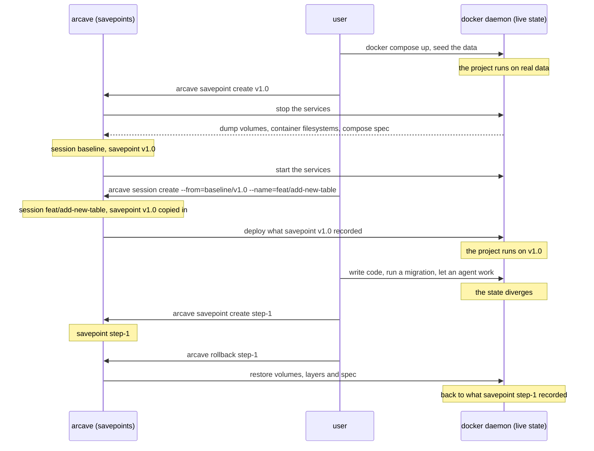
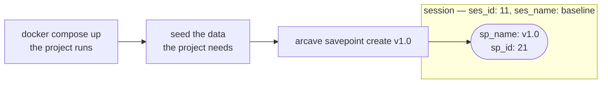
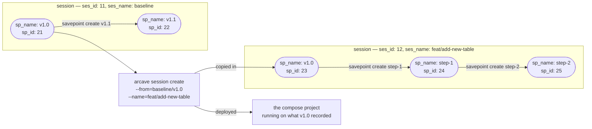
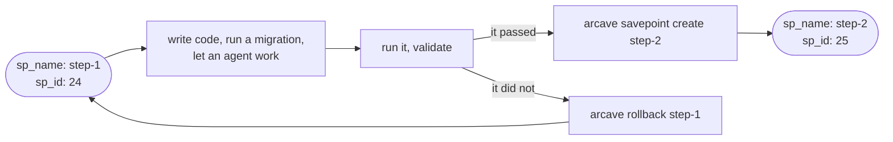

# About arcave

## Ephemeral environments and branching for your Docker Compose project

Your code is versioned. The state your environment accumulates is not — and that asymmetry is why a bad migration costs an afternoon.

**arcave** gives a Docker Compose project the semantics you already have for code: save the whole state, come back to it, and branch off any saved point. It does not save your source tree; it saves the live environment underneath it — the volumes, the container filesystems, and the compose specification the project was running under.

**It runs on the Docker you already have.** No ZFS, no copy-on-write filesystem, no storage appliance, no daemon to reconfigure. Two things: Docker, and the arcave binary.

**Any compose project.** Postgres, MySQL, Kafka, Redis, MinIO, your own services — whatever is in your compose file. There is no allowlist, because arcave reads the project your daemon is running rather than guessing at what the services are.

Bring the project up, get it to a production-like state with real data, save it — and come back to that state in seconds instead of rebuilding it. Try a migration, an experiment, an agent session; when it goes wrong, go back. People and agents do the same thing at different speeds.

```shell title="The whole idea"
arcave savepoint create before-migration
# ...run the migration, the test suite, the agent...
arcave rollback before-migration
```

### You, arcave and the daemon

You are between two things: the savepoints arcave keeps, and the live state your Docker daemon is running. Every arcave command moves state across that gap. `savepoint create` reads the live state into a savepoint. `rollback` writes a savepoint back into the daemon. `session create --from` does both: it copies a savepoint into a new session, then deploys that state into the daemon.



### A savepoint is a state you named

Bring the project up, get it to the state you want to keep, and save it. `arcave savepoint create v1.0` records the whole environment as one savepoint in the session you are working in — `baseline` on the diagram below.

A session and a savepoint each carry an id and a name. The three diagrams below show both, so four labels appear on them:

| Label | What it is |
|---|---|
| `ses_id` | the session's identifier |
| `ses_name` | the name you gave the session |
| `sp_id` | the savepoint's identifier |
| `sp_name` | the name you gave the savepoint |

An id is what the thing is, and arcave assigns it. A name is what you address it by, and you choose it. Both work as selectors: `rollback` and `--from` take either one. The ids on the diagrams are shortened to two digits so the pictures stay readable; a real one is a UUID.



### A fork starts a second line and deploys it

`arcave session create --from=baseline/v1.0 --name=feat/add-new-table` opens a second line beside `baseline`. The point that line starts from is a savepoint of its own: it carries the same `sp_name` — `v1.0`.

The fork deploys that state into the daemon, and the commands that follow name the session they work in. [`arcave session`](reference/cli/session.md) has both in full.



### A step ends in a savepoint

Inside the session the work is a loop, and each turn of it ends in one of two commands. If the run passed, `arcave savepoint create step-2` records the new state as another savepoint of the same session. If it did not, `arcave rollback step-1` puts the environment back to `step-1` — the savepoint the step started from. People and agents run the same loop at different speeds.



## What a savepoint holds

Three things, and they do not overlap:

* **Volumes and mounts** — named volumes, bind mounts and anonymous volumes, for every service in the project. A named volume three services share is captured once.
* **Container filesystem** — what a service wrote *outside* all of its mounts. It is captured together with the volumes, and a rollback puts it back together with them.
* **Compose specification** — the Docker Compose spec of the project as it was running, with environment variables resolved to the values the containers actually had. A rollback rebuilds the services, images, ports and networks it records, not the ones running now.

## How a savepoint is taken

Every service of the compose project is stopped, the whole environment is captured, and the services are started again. Nothing is captured mid-write, so a database comes back without a crash-recovery pass on start.

Volume data is moved one of two ways, chosen by `snapshot.backend` in `.arcave/config.yaml`. `fullcopy` streams each mount through the Docker API. `cdc` writes only the chunks that changed since the last savepoint, so the second savepoint of a project costs a fraction of the first, and a rollback rewrites less. Container filesystems are deduplicated either way: the base layer shared by every savepoint is stored once.

## Sessions

A **session** is an independent line of savepoints inside a project. A session starts empty or from a savepoint of another session, and the lines do not mix. A branch is a session, and its name is the session's name.

`arcave init` puts you in `baseline`, the default session. A command that names no session works there, which is why the diagrams above start in it. Creating a session does not switch you into it: you name the one you want with `--session` or `ARCAVE_SESSION`, by id or by name.

A fork copies the data it starts from rather than sharing it with the session it came from. That is what keeps the two lines independent — nothing one of them writes can reach the other — and it is why a fork costs the size of the savepoint it starts from.

Sessions and savepoints alike keep an id of their own, and a name is what you address them by. Either works as a selector: `arcave rollback` and `--from` take an id or a name.

One form reaches across sessions, and only one: `--from`. `baseline/v1.0` names the savepoint `v1.0` in the session `baseline`, and `--from=baseline` names that session's latest. Every other command resolves a name inside the session it was given, because it does not need more: the fork copies the point it started from into the new session, so `v1.0` is there to roll back to by its own name.

```shell
arcave session create --from=baseline/v1.0 --name=feat/add-new-table
```

## Where to start

* **[Installation](installation.md)** — install the binary and check the requirements.
* **[Getting started](getting_started.md)** — initialise a project, take your first savepoint, roll it back.
* **[Testing destructive migrations](use_cases/migration_testing.md)** — run the migration for real, against real data, as many times as it takes.
* **[Agent iteration loops](use_cases/agent_loops.md)** — let an agent take its own savepoint before it acts, and roll back when validation fails.
* **[How arcave works](how_it_works.md)** — the mechanism, end to end.
* **[Limitations](reference/limitations.md)** — what arcave does not do, stated plainly, before you build on it.

## Links

* [GitHub](https://github.com/GreenmaskIO/arcave)
