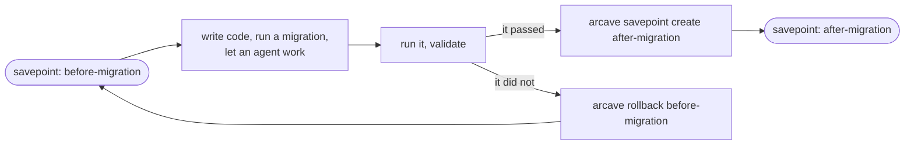

import ArcaveLockup from './assets/arcave-lockup-brand-on-light.svg';

<ArcaveLockup width={320} style={{display: 'block', marginBottom: '2rem'}} />

<p>
  <a href="https://github.com/GreenmaskIO/arcave">
    
  </a>{' '}
  <a href="https://github.com/GreenmaskIO/arcave/releases/latest">
    
  </a>{' '}
  <a href="https://github.com/GreenmaskIO/arcave/blob/main/LICENSE">
    
  </a>
</p>

# About

**Ephemeral environments and branching for your Docker Compose project.**

Your code is versioned. The state your environment accumulates is not — and that asymmetry is why a bad migration costs an afternoon.

<video src={require('./assets/demo/base-cycle.mp4').default} autoPlay loop muted playsInline controls width="100%" />

**arcave** gives a Docker Compose project the semantics you already have for code: save the whole state, come back to it, and branch off any saved point. It does not save your source tree; it saves the live environment underneath it — the volumes, the container filesystems, and the compose specification the project was running under.


**It runs on the Docker you already have.** No ZFS, no copy-on-write filesystem, no storage appliance, no Docker daemon to reconfigure. Two things: Docker, and the arcave binary.

**Any compose project.** Postgres, MySQL, Kafka, Redis, MinIO, your own services — whatever is in your compose file. There is no allowlist, because arcave reads the project your daemon is running rather than guessing at what the services are.

Bring the project up, get it to a [production-like state with real data](use_cases/prod_like_data.md), save it — and come back to that state in seconds instead of rebuilding it. Try a migration, an experiment, an agent session; when it goes wrong, go back. People and agents do the same thing at different speeds.

```shell title="The whole idea"
arcave savepoint create before-migration
# ...run the migration, the test suite, the agent...
arcave rollback before-migration
```

*What it shows:* a savepoint, a dropped table, `arcave rollback` — and the rows are back.



## What a savepoint holds

Four things, and they do not overlap:

* **Volumes and mounts** — named volumes, bind mounts and anonymous volumes, for every service in the project. A named volume three services share is captured once.
* **Container filesystem** — what a service wrote *outside* all of its mounts. It is captured together with the volumes, and a rollback puts it back together with them.
* **Images** — the image each service's `image:` names, kept once however many savepoints and replicas use it.
* **Compose specification** — the Docker Compose spec of the project as it was running, with environment variables resolved to the values the containers actually had. A rollback rebuilds the services, images, ports and networks it records, not the ones running now.

All of it is captured by default; `arcave.*` labels in your compose file can leave a service, a volume, a layer or an image out — see [Capture labels](reference/capture_labels.md).

## How a savepoint is taken

Every service of the compose project is stopped, the whole environment is captured, and the services are started again. Nothing is captured mid-write, so a database comes back without a crash-recovery pass on start.

## Sessions

Savepoints live in a **session** — an independent line of them inside the project. `arcave init` puts you in `baseline`, and a fork copies a whole session into a new one beside it: that is what a branch is here.

## Where to start

* **[Installation](installation.md)** — install the binary and check the requirements.
* **[Getting started](getting_started.md)** — initialise a project, take your first savepoint, roll it back.
* **[Sessions and branching](sessions.md)** — the lines savepoints live in, and how a fork copies one into a new one.
* **[Testing destructive migrations](use_cases/migration_testing.md)** — run the migration for real, against real data, as many times as it takes.
* **[Agent iteration loops](use_cases/agent_loops.md)** — let an agent take its own savepoint before it acts, and roll back when validation fails.
* **[How arcave works](how_it_works.md)** — the mechanism, end to end.
* **[Limitations](reference/limitations.md)** — what arcave does not do, stated plainly, before you build on it.

## Links

* [GitHub](https://github.com/GreenmaskIO/arcave)
