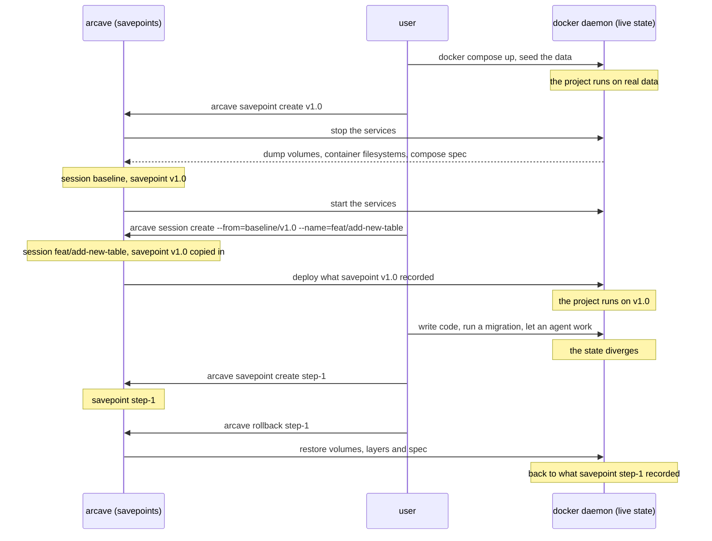
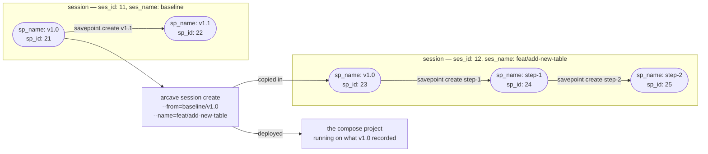

# Sessions and branching

A **session** is an independent line of savepoints inside a project. A session starts empty or from a savepoint of another session, and the lines do not mix. A branch is a session, and its name is the session's name.

`arcave init` puts you in `baseline`, the default session. A command that names no session works there, which is why the diagrams below start in it. Creating a session does not switch you into it: you name the one you want with `--session` or `ARCAVE_SESSION`, by id or by name.

A fork copies the data it starts from rather than sharing it with the session it came from. That is what keeps the two lines independent — nothing one of them writes can reach the other — and it is why a fork costs the size of the savepoint it starts from.

## You, arcave and the daemon

You are between two things: the savepoints arcave keeps, and the live state your Docker daemon is running. Every arcave command moves state across that gap. `savepoint create` reads the live state into a savepoint. `rollback` writes a savepoint back into the daemon. `session create --from` does both: it copies a savepoint into a new session, then deploys that state into the daemon.



## Ids and names

A session and a savepoint each carry an id and a name. The diagrams below show both, so four labels appear on them:

| Label | What it is |
|---|---|
| `ses_id` | the session's identifier |
| `ses_name` | the name you gave the session |
| `sp_id` | the savepoint's identifier |
| `sp_name` | the name you gave the savepoint |

An id is what the thing is, and arcave assigns it. A name is what you address it by, and you choose it. Both work as selectors: `rollback` and `--from` take either one. The ids on the diagrams are shortened to two digits so the pictures stay readable; a real one is a UUID.

## A savepoint is a state you named

Bring the project up, get it to the state you want to keep, and save it. `arcave savepoint create v1.0` records the whole environment as one savepoint in the session you are working in — `baseline` on the diagram below.


## A fork starts a second line and deploys it

`arcave session create --from=baseline/v1.0 --name=feat/add-new-table` opens a second line beside `baseline`. The point that line starts from is a savepoint of its own: it carries the same `sp_name` — `v1.0`.

The fork deploys that state into the daemon, and the commands that follow name the session they work in. [`arcave session`](reference/cli/session.md) has both in full.



## Addressing across sessions

One form reaches across sessions, and only one: `--from`. `baseline/v1.0` names the savepoint `v1.0` in the session `baseline`, and `--from=baseline` names that session's latest. Every other command resolves a name inside the session it was given, because it does not need more: the fork copies the point it started from into the new session, so `v1.0` is there to roll back to by its own name.

```shell
arcave session create --from=baseline/v1.0 --name=feat/add-new-table
```

## Related docs

* [`arcave session`](reference/cli/session.md) — the command, its flags and its errors.
* [Environment branching](use_cases/environment_branching.md) — the workflow a fork is for, and where the branching analogy stops.
* [How arcave works](how_it_works.md) — what a savepoint captures and what a rollback restores.
