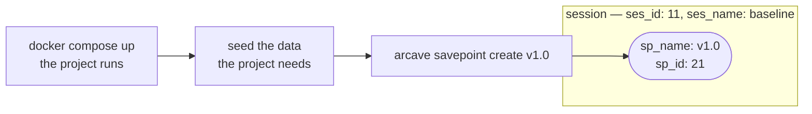
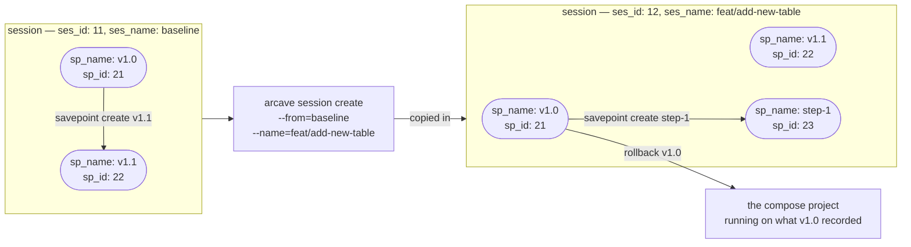

# Sessions and branching

A **session** is an independent line of savepoints inside a project. A session starts empty or as a copy of another session, and the lines do not mix. A branch is a session, and its name is the session's name.

`arcave init` puts you in `baseline`, the default session, which is why the diagrams below start in it. Creating a session does not switch you into it. A command works in the session you name with `--session` or `ARCAVE_SESSION`, by id or by name; when you name none, it works in the **current session**, and in `baseline` when no current session is set:

| Command | What it does |
|---|---|
| `arcave session set <session>` | Makes `<session>` the current one. |
| `arcave session current` | Shows the current session. |
| `arcave session unset` | Goes back to `baseline`. |

The current session is recorded in `.arcave/current_session`, so it holds for this project directory on this host only. A current session that has since been deleted is an error, never a silent fall back to `baseline`, and deleting the current session takes `--force`, which also clears it.

A fork copies the session it starts from rather than sharing data with it. That is what keeps the two lines independent — nothing one of them writes can reach the other — and it is why a fork costs the size of the session it copies.

A session and a savepoint each carry an id and a name. An id is what the thing is, and arcave assigns it. A name is what you address it by, and you choose it. Both work as selectors: `--session`, `--from` and `rollback` take either one.

## A savepoint is a state you named

Bring the project up, get it to the state you want to keep, and save it. `arcave savepoint create v1.0` records the whole environment as one savepoint in the session you are working in — `baseline` on the diagram below.

:::note
The diagrams label both, so four names appear on them:

| Label | What it is |
|---|---|
| `ses_id` | the session's identifier |
| `ses_name` | the name you gave the session |
| `sp_id` | the savepoint's identifier |
| `sp_name` | the name you gave the savepoint |

The ids are shortened to two digits so the pictures stay readable; a real one is a UUID.
:::



## A fork copies the line, a rollback deploys it

`arcave session create --from=baseline --name=feat/add-new-table` opens a second line beside `baseline`, holding a copy of everything `baseline` holds — every savepoint of every compose project, with the same ids and names, the safety snapshots, and the data they share. The Docker daemon is not touched: the project keeps running whatever it ran.

To start working on a state of the new line, roll back to it there: `arcave rollback --session=feat/add-new-table -p shop v1.0`. That is an ordinary rollback, safety snapshot included. The commands that follow name the session they work in. [`arcave session`](reference/cli/session.md) has both in full.



A savepoint id is unique within its session, not across sessions: the copy of `v1.0` is `21` on both lines. Every command resolves a savepoint inside the session it was given, so the two never meet.

```shell
arcave session create --from=baseline --name=feat/add-new-table
export ARCAVE_SESSION=feat/add-new-table   # or: arcave session set feat/add-new-table
arcave rollback -p shop v1.0
```

<video src={require('./assets/demo/sessions.mp4').default} autoPlay loop muted playsInline controls width="100%" />

*What it shows:* `session create --from baseline` copies the baseline into `feature-x`; with `feature-x` current, a dropped table and its savepoint stay in `feature-x`; `session list` shows both lines; back in `baseline`, `rollback seed` brings the table back.

## Related docs

* [`arcave session`](reference/cli/session.md) — the command, its flags and its errors.
* [Environment branching](use_cases/environment_branching.md) — the workflow a fork is for, and where the branching analogy stops.
* [How arcave works](how_it_works.md) — the whole arc between the savepoints and the Docker daemon, and what a savepoint captures.
